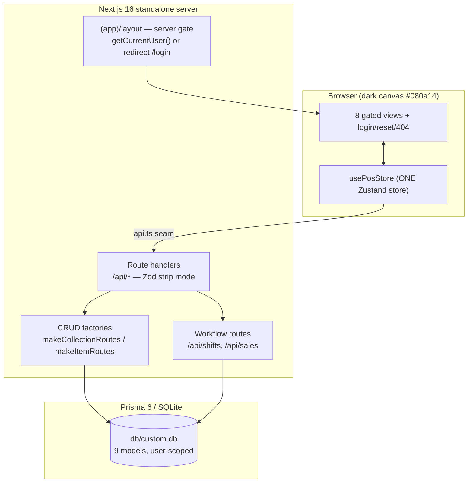

# VeloxPOS — Master Project Architecture Document (PAD) v1.17

**Classification:** Internal Engineering Reference
**Status:** DEFINITIVE, PRODUCTION BLUEPRINT
**Companion documents:** `README.md` (tour) · `AGENTS.md` (agent invariants) · `CLAUDE.md` (Claude conventions) · `docs/veloxpos-implementation-plan.md` (the measured reference spec)
**Last Updated:** 2026-10-28 (Session-19)
**Audience:** Senior engineers, tech leads, DevOps, onboarding engineers, and AI coding agents
**Rule:** Every architectural decision in this document traces to a specific rationale. Nothing is here "because it's popular."

---

## 1. Executive Summary

VeloxPOS is a production-grade Point of Sale web application delivering the complete counter
workflow — cash registers with shift management, a barcode-first selling terminal, inventory with
low-stock tracking, cashier accounts, and period-filtered sales analytics. It is a functional
**superset** of the reference deployment at `veloxposen.base44.app` (a base44-hosted app whose
demo account is read-only) with **measured visual parity**: routes, tokens, copy, and empty states
were extracted from the live reference via browser automation (computed styles, not screenshots)
and re-implemented on an owned stack.

The engineering thesis: a small set of **pure, unit-pinned domain seams** (money, cart, shift,
reports, validation) underneath **server-gated thin routes**, a **single Zustand store**, and a
**factory-based API layer** with ownership scoping by construction. The local gate
(lint → typecheck → unit → build → e2e) is the only gate — there is no hosted CI — so every
guardrail is enforced by tooling that runs in this checkout.

**Scale & baselines (verified 2026-10-27, Session-16 re-certification):** 9 Prisma models · 26 API
route files · 8 gated views (9 route spellings — the root `/` page is the
terminal's reference-parity landing, Session-10 F-60)
+ login/reset/404 · 149 unit tests (14 files) · 105 e2e tests (2 browser projects) · standalone
production build.

## 2. Tech Stack (version-pinned)

| Layer | Technology | Version | Rationale |
|---|---|---|---|
| Framework | Next.js (App Router, `output: "standalone"`) | ^16.4.2 | Server Components gate sessions; standalone traces a minimal deployable server |
| UI runtime | React | ^19 | The platform's current runtime; no `forwardRef` era patterns |
| Language | TypeScript (strict) | ^5 | `tsc --noEmit` is the fast gate; the build enforces (`ignoreBuildErrors: false`) |
| Styling | Tailwind CSS (CSS-first) | ^4 | No config file — tokens in `@theme`; the ten v3→v4 traps are pinned in code |
| Primitives | Radix UI (shadcn-style, `src/components/ui`) | latest | Accessible dialogs/selects/switches — never hand-rolled (the toaster is the deliberate zustand exception, documented in its header) |
| State | Zustand | ^5.0.15 | ONE store (`usePosStore`); selectors with `useShallow` semantics |
| ORM | Prisma / SQLite | ^6.19.3 | 9 models; ownership scoping by construction; `db-path.ts` anchors the file |
| Validation | Zod | ^4.6.5 | Strip mode at every API boundary |
| Auth | scrypt + HMAC (hand-rolled, `node:crypto`) | — | Minimalist by design (ADR-002); no auth library |
| Charts | Hand-rolled SVG components | — | Zero dependencies; pixel-controlled parity (ADR-006) |
| Unit tests | Vitest | ^5 | Pure-seam coverage (`tests/unit/**`) |
| E2E | Playwright | ^1.63 | Production-standalone journeys; desktop + mobile projects |
| Runtime | Bun | ≥1.1 | Dev, scripts, and test execution throughout |

## 3. System Topology



Request flow for the hottest path (checkout): cart (client, pure seam) → `POST /api/sales`
(Zod validates → products re-read and re-priced server-side → totals recomputed in integer cents →
stock decremented + sale written + ticket allocated in one transaction → shift pinned) → receipt
dialog renders the persisted row. Client totals are display-only by construction.

## 4. Architecture Decision Records (condensed)

### ADR-001 — Real routes instead of a view-switcher SPA
**Decision:** The 8 views live at their reference paths (`/POS`, `/Dashboard`, …) as genuine
routes under `src/app/(app)/`. **Rationale:** the reference itself navigates real paths (measured:
the sidebar links carry hrefs; deep links like `/Registers` resolve directly); real routes make
the server gate enforceable per navigation and the URLs shareable. The previous scaffolding
generation used one page + rewrites — abandoned because the reference contract outranks it.

### ADR-002 — Hand-rolled auth (scrypt + HMAC cookie)
**Decision:** Minimalist auth on `node:crypto` — scrypt password hashes (`scrypt$salt$key`),
HMAC-signed stateless session tokens in an httpOnly cookie (`sf_session`, 7-day TTL, SameSite
Lax). **Rationale:** the surface (owner + cashiers, email/password) does not justify a library;
the boot guard (`instrumentation.ts` exits production without a real `AUTH_SECRET`) and the
rate limiter (10 attempts/IP/15 min on public endpoints) cover the risk. `COOKIE_SECURE=false`
is the single documented escape hatch for plain-HTTP production-style servers.

### ADR-003 — Server-authoritative checkout
**Decision:** `POST /api/sales` re-prices every line from stored product data, verifies stock,
allocates the sequential ticket, pins the register's active shift, and decrements stock in one
transaction. **Rationale:** a POS that trusts client totals is a loss machine; the reference's
demo cannot express this constraint at all (its writes 403), so the superset defines the honest
implementation.

### ADR-004 — The mobile drawer a11y superset
**Decision:** Below `md`, navigation is a labeled hamburger → slide-in `role="dialog"` drawer
(glass-dark, backdrop, Escape, route-change unmount, scroll lock). **Rationale:** the reference
keeps a 220px sidebar overlaying phone content with no dismissal — a genuine defect (measured at
390×844: no hamburger, content clipped behind the cart panel). The clone keeps desktop parity
pixel-faithful and replaces the broken mobile experience with the documented accessible pattern;
the contract is pinned by `tests/e2e/mobile-navigation.spec.ts` (13 tests).

### ADR-005 — Plain-CSS custom classes (the Tailwind v4 cascade rule)
**Decision:** The measured `glass-*` system, `brand-chip`, and focus utilities are plain CSS in
`src/app/tokens.css`; gradients exist only as classes. **Rationale:** in Tailwind v4, custom
classes inside `@layer utilities` emit after generated utilities and silently lose the cascade to
arbitrary utilities on the same element — the documented drawer-styling killer. Utility gradients
were additionally ruled out because v4 interpolates in oklab and drifts from the measured 135°
sRGB stops.

### ADR-006 — Hand-rolled SVG charts
**Decision:** The dashboard line chart and reports area chart are small React SVG components
(dotted grid, violet stroke) fed by pure seams. **Rationale:** zero new dependencies, exact
control over the measured visual (grid dashes, tick labels, stroke), and the data transforms
(bucketing, shares) are unit-pinned pure functions — chart libraries would add bundle weight for
two plots and blur the parity contract.

### ADR-010 — The Session-5 parity pins (the @theme inline fix + the form-control/button contracts)
**Decision:** (1) `tokens.css` switches `@theme` → **`@theme inline`**: the non-inline form bakes
`hsl(var(--input))` into `--color-input` AT `:root`, so the `.theme-light` login scope's triplet
re-pointing could never reach themed utilities (live-proven: `--color-input` read the dark
value inside the light wrapper; the login inputs rendered dark borders on the light card).
Inline emits `hsl(var(--input))` directly in each utility rule (verified in the built CSS:
`.border-input{border-color:hsl(var(--input))}`). (2) The form-control contract moves into the
base components: Input/Select/Textarea compute `rounded-xl` (12px) + `border-input` (#262a36) +
transparent bg + `#707a8f` placeholders + ring-1 focus — 34 per-field `border-edge bg-white/5`
compensating overrides were stripped; the `:root` tokens adopt the reference's app-scoped
values (`--input`/`--border` `225 18% 18%`, `--muted-foreground` `220 12% 50%`, `--ring`
`252 87% 67%`). (3) The Button default size is `px-4 py-2.5` (padding-driven 42px — no fixed
h-9); CHARGE is `py-5` (70px). (4) The receipt footer is a TEXTAREA (rows=2, multi-line
footers — a functional superset of the single-line input it replaces). (5) The login surface
adopts the reference's form internals: 48px slate-filled inputs (DIRECT slate classes, not
themed utilities), the bg-white/95 + shadow-2xl card with the 4px top gradient strip, the
vendored logo image (`public/veloxpos-logo.png`, 96×96), 54px SSO buttons, font-medium
sign-in. (6) The Reports period pills adopt the reference's geometry (rounded-2xl container,
rgba(28,31,52,0.85) fill, text-xs bold pills, shadow-lg active state).
**Rationale:** a computed-style census at the form-control depth the earlier sessions never
measured (the full ledger is `docs/remediation-plan-session-5.md`). Every item is
user-visible parity; each is e2e-pinned (13 new pins: settings/dialog/search input geometry,
textarea, pills, buttons ×2, select trigger, login inputs/card strip/logo/sign-in/SSO). The
login inputs use direct slate classes AND the theme mechanism was fixed at the root — the
symptom fix and the mechanism fix are both shipped (skill doctrine: fix the cause, not the
symptom).

### ADR-009 — The Session-4 parity pins (heading scale, fiscal rename + inverted toggle, Added banner)
**Decision:** (1) Heading sizes align to the reference's computed styles: page H1s `text-2xl`
(24px), section headings `text-base` (16px), Reports section headings `text-sm` (14px)
uppercase — while KEEPING the clone's readable white/violet colors (the reference renders its
headings in near-invisible slate-700/800 on dark glass; pixel-verified as its own defect — the
same a11y-superset posture as the mobile drawer). (2) The fiscal card follows the reference's
CURRENT labels (it renamed them live after Session-101: RUC/NIT → "Tax ID / EIN", business
type → "Tax Regime", expense account → "CFDI Use (default)") and its toggle contract: mounted
in the SectionCard header row, default = fiscal hidden on receipts (`hideFiscalOnReceipt
@default(true)`), the UI switch wired INVERTED (`checked={!hideFiscalOnReceipt}` — ON =
"Visible on receipt"), plus the reference's help paragraph. (3) The cart gains the reference's
"Added" auto-collapsing banner (emerald chip, product name, `transition-all duration-300`,
~2.5s hold; timer state in the click handler — no setState-in-effect). (4) The login canvas
matches the reference's slate gradient and its single-phrase "Need an account? Sign up"
slate-500 button.
**Rationale:** every item is a computed-style/drift measurement against the live reference
(the full ledger is `docs/remediation-plan-session-4.md`); the reference DRIFTS between
sessions, so its live computed styles — not the Session-101 snapshot — are the parity contract.
Each behavioral item is e2e-pinned (10 new pins: heading sizes ×3, copy casing ×2, fiscal
labels, fiscal toggle default + copy, Added banner, login gradient, signup button).

### ADR-008 — The Session-3 parity pins (tw-animate, hover unwrap, drawer focus superset)
**Decision:** `globals.css` imports `tw-animate-css` (restoring the Radix `data-[state]`
animation family — dialogs/selects/toasts animate like the reference's v3-era CSS) and declares
`@custom-variant hover (&:hover);` (un-wrapping v4's `@media (hover: hover)` so hovers apply on
touch devices, matching the reference — a POS runs on tablets). The mobile drawer gains the
focus-management superset (focus moves to the close button on open, Tab wraps, focus restores to
the hamburger on close, and the drawer auto-closes when the viewport grows past `md` — the
neo-crm S8-P1 bug class). The cart side panel activates at `md` (the reference's own breakpoint).
**Rationale:** all four are measured-parity deltas against the live reference or family-standard
bug classes; each is e2e-pinned (the dialog animation-name pin, the three drawer focus pins, the
md-growth pin, the cart-md geometry pin). The drawer keeps its instant exit (conditional unmount)
so the e2e UNMOUNT pins stay deterministic.

### ADR-007 — The db-path resolution contract
**Decision:** `src/lib/db-path.ts` resolves relative `file:` DATABASE_URLs against the first
anchor owning `prisma/schema.prisma` (standalone-dir detector → module anchor → CWD), exactly
like the Prisma CLI. **Rationale:** the standalone server chdirs into `.next/standalone`, so a
naive CWD rule would point production at the build output. Absolute `file:` URLs pass through —
and are the documented production form, because per-bundle anchors under standalone are a
field-tested desynchronization source (e2e evidence in §9).

## 5. Layer Model

```
┌──────────────────────────────────────────────────────────────────┐
│ Views (client) — src/components/pos/views/*.tsx                  │
│   render-only; state from usePosStore; toasts on failures        │
├──────────────────────────────────────────────────────────────────┤
│ Client seams — src/lib/{api,store,router,cart,money,...}.ts      │
│   api.ts (fetch + envelope + offline classification)             │
│   pure domain math — unit-pinned, framework-free                 │
├──────────────────────────────────────────────────────────────────┤
│ HTTP boundary — src/app/api/**/route.ts                          │
│   3-line shells over factories; Zod at the door; error mapper    │
├──────────────────────────────────────────────────────────────────┤
│ Domain services — src/lib/server/{entities,auth}.ts              │
│   delegates (ownership-scoped) · workflows (shifts, checkout)    │
├──────────────────────────────────────────────────────────────────┤
│ Persistence — Prisma client (src/lib/db.ts) → SQLite file        │
│   9 models; user-owned rows; cascade deletes; JSON columns only  │
│   for sale items (read-model blobs)                              │
└──────────────────────────────────────────────────────────────────┘
```

Dependency rule: arrows point downward only. `src/lib` pure seams never import React or Prisma;
`src/lib/server/**` may import both; views import client seams, never the server layer.

## 6. Directory Structure (annotated)

```
📂 velox-pos
 ├ 📂 src/app
 │  ├ 📂 (app)/            — POS · Dashboard · Inventory · Sales · Registers · Cashiers ·
 │  │                        Reports · StoreSettings (each: server page → client view) + layout.tsx gate
 │  ├ 📂 api/auth/         — login · register · logout · me · forgot/reset/change-password ·
 │  │                        change-email · verify-email · resend-verification · delete-account
 │  ├ 📂 api/{products,categories,registers,cashiers}/[id] — CRUD shells over the factories
 │  ├ 📂 api/{shifts,sales}/[id] — workflows (open/close shift; checkout/receipt/refund)
 │  ├ 📂 api/{store-settings,health} — settings singleton · liveness
 │  ├ 📄 login/page.tsx    — the light reference card (public)
 │  ├ 📄 reset-password/page.tsx — token consumption (public)
 │  ├ 📄 not-found.tsx     — Spanish 404 ("Página no encontrada / Ir al Terminal")
 │  └ 🎨 globals.css + tokens.css — @theme pins; glass system; login light scope
 ├ 📂 src/components/pos   — app-shell (sidebar+drawer) · nav-items · shared (PageHeader,
 │                           StatCard, SVG charts) · pages.tsx · login/reset surfaces ·
 │                           use-pos-bootstrap.ts · views/ (8 view files)
 ├ 📂 src/components/ui    — shadcn-style Radix primitives, the 10 live files
 │                           (alert, alert-dialog, button, dialog, input, label,
 │                           select, switch, textarea, toast)
 ├ 📂 src/lib              — pure seams (money, cart, shift, reports, inventory-status,
 │                           currency, router, validation, auth, chart-path, site, env-check,
 │                           db-path, db, store, api, utils) + server/ (http, auth, entities)
 ├ 📂 prisma               — schema.prisma (9 models) · seed.ts (owner + settings; --demo dataset)
 ├ 📂 tests/unit           — 14 vitest files (the seam registry + the docs-counts gate)
 ├ 📂 tests/e2e            — 7 spec files + auth.setup + kill-port + provisioning
 ├ 📂 docs                 — implementation plan, runbooks, Tailwind report, screenshots/
 └ ⚙️ next.config.ts · playwright.config.ts · vitest.config.ts · package.json · .env.example
```

## 7. Data Model (Prisma/SQLite)

| Model | Key fields | Relations & rules |
|---|---|---|
| `User` | email (unique), passwordHash, fullName, **role** (`owner`\|`cashier`), active, emailVerified | Owner of everything; named back-relations `ShiftCashier`/`SaleCashier` |
| `StoreSettings` | storeName, logoDataUrl, contact fields, currency, primary/secondaryColor, receiptFooter, hideFiscalOnReceipt, fiscal* fields, cardProvider | 1:1 per owner (userId unique); lazily materialized on first GET |
| `Category` | name, color | unique per (userId, name); products SetNull on delete |
| `Product` | name, barcode, price, cost?, stock, minStock, taxRate, unit, image?, active | categoryId nullable (SetNull); barcode indexed for terminal search |
| `Register` | name, location, status (`closed`\|`open`) | status mirrors its shift lifecycle; delete refused with shift history |
| `CashierShift` | registerId, cashierId, openedAt/closedAt, openingFloat, countedCash?, expectedCash?, variance?, status | One ACTIVE shift per register (workflow-enforced); expected/variance computed server-side at close |
| `Sale` | ticket (`T-000001`), items (JSON lines), subtotal/taxTotal/total, paymentMethod (`cash`\|`card`), amountPaid?, changeDue?, customer?, status | Pinned to register + shift; refund = status flip; ticket allocated from the store's sale count |

**Invariants (pinned by tests + workflows):** every user-owned row carries `userId` with
`onDelete: Cascade`; money crosses the seam as 2dp dollars and is computed in integer cents;
the only JSON column is `Sale.items` (a read-model blob of the priced lines). Plus the
auth-support pair — `VerificationToken` (6-digit OTP, 15-minute window) and
`PasswordResetToken` (48-hex one-shot, 30-minute window), both `userId`-owned with
`onDelete: Cascade` — the POS-domain table above plus this pair is the schema's 9 models.

## 8. Security Architecture

| Control | Implementation |
|---|---|
| Password storage | scrypt (16-byte salt, 64-byte key, `timingSafeEqual` verify) |
| Sessions | HMAC-SHA256 over `{uid, iat, exp}` (base64url), httpOnly + SameSite Lax cookie, 7-day TTL |
| Secret governance | Production boot guard exits loudly on missing/weak `AUTH_SECRET`; dev fallback constant is public and warn-tagged |
| Rate limiting | Fixed-window in-memory (10/IP/15 min) on login/register/forgot — the e2e suite's storageState reuse exists because of this |
| Input validation | Zod strip mode at every boundary; length caps; enum membership; hex-color and data-URL refinements; `"" → null` transforms |
| Ownership | Every query scoped by `userId`; mutations verify ownership before acting; cashiers additionally role-guarded (owner-only management, cashier rows never hard-deleted while shifts exist) |
| Error surface | Uniform `{ error }` JSON; Zod → 400, unique → 409, missing → 404, unauthed → 401; unknown errors log server-side only (never the body) |
| Uploads | Product images and the store logo are client-downscaled data URLs (≤2 MB), validated by prefix — no filesystem writes |

## 9. Testing Strategy & the Local Gate

```
lint → typecheck → unit → build → smoke → e2e
```

1. **Unit (Vitest, 149/149):** the pure seams — money (cents math, formatting), cart (reducer,
   totals, charge gate), shift (state machine, variance), reports (bucketing, shares),
   inventory-status + CSV round-trip, currency, router (the route map), validation (accept/reject
   matrix), auth (hash/token/rate-limit), db-path (the resolution contract), env-check, site.
   Baseline: 14 files. New seams arrive with their file; fixes arrive with regression tests.
2. **E2E (Playwright, 105/105):** production standalone on :3100, scratch db (`db/e2e.db`)
   provisioned by the webServer command (kill-port → provision → boot — never touched while the
   server lives). Projects: `chromium` (1440×900; journeys) and `mobile` (390×844; the drawer
   suite). Auth once via storageState. The spec map: `auth` (the light card + gating + from_url),
   `navigation` (sidebar order/activation/collapse/persistence), `mobile-navigation` (the 13
   drawer pins — including the Session-3 focus-trap/restore and md-growth auto-close),
   `inventory` (CRUD + search + CSV-adjacent flows), `registers-shifts` (the
   lifecycle), `terminal` (cart math, cash checkout + change, ticket, receipt, stock decrement),
   `surfaces` (Sales/Cashiers/Reports/Settings/404/health + the dialog-animation and
   cart-md-geometry parity pins).
3. **Field-tested e2e doctrine:** auth waits for the hydration-gated submit button (`toBeEnabled`)
   before filling; assertions use visibility (not DOM count) for `hidden md:*` elements; the
   scratch db is never replaced while the server lives (clients bind the inode; field-tested
   desynchronization); the port is freed before boot (`tests/e2e/kill-port.ts`).

## 10. Build & Deployment

- `bun run build` → standalone output at `.next/standalone` (static + public copied in).
- Production boot: `DATABASE_URL="file:<ABSOLUTE>" AUTH_SECRET=<64-hex> PORT=3000 bun
  .next/standalone/server.js` — the boot guard fails fast on secret problems; relative URLs are a
  dev convention (ADR-007).
- `COOKIE_SECURE=false` only for plain-HTTP production-style deployments (documented in
  `.env.example`; the e2e server uses it).
- Push path: commits on `main`, then `docs/ssh_git_wrapper_v3.py` with an operator-supplied key
  (0600 temp file outside the repo, dry-run → push → remote ref verified → shredded). Runbook:
  `docs/how-to-git-push-using-ssh-wrapper_SKILL.md`.

## 11. Developer Handbook (the 20-minute onboarding)

1. Read `README.md` (tour) → this §5/§6 (layers + map) → `AGENTS.md` (invariants).
2. Provision: `cp .env.example .env` → set `AUTH_SECRET` → `bun run db:push && bun run db:seed`
   → `bun run dev`. Verify `/api/health` → `{"status":"ok","db":"up","app":"veloxpos"}`.
3. Sign in (`sepnetflix2023@outlook.com` / `$Abcd1234`), walk the 8 views, then run the gates.
4. To add a feature: write the seam + its unit test first (red), wire the Zod contract, extend the
   delegate or workflow route, then the view; update the e2e journey if the flow is user-visible.
5. To change the design system: measure the live reference first (agent-browser, computed
   styles), record the measurement in the plan doc, then move the token — never eyeball.

## 12. Known Issues & Deliberate Simplifications

| Item | Status | Note |
|---|---|---|
| `/Settings` route 404s | By design | Reference parity — the sidebar href is `/StoreSettings`; pinned by e2e |
| Mixed EN/ES copy | By design | The reference's own quirk (Sales/Cashiers/404 are Spanish); preserved verbatim |
| Rate limiter is in-memory | Documented | Single-instance deployment contract; horizontal scaling needs a shared store |
| Cashier accounts are global | Documented | Cashier users are role-scoped rows, not per-owner rows — acceptable for the single-store deployment this targets |
| Refunds do not restock | Documented | Refund flips the status; stock restoration is a manual Inventory action |
| CSV import trusts category names | Guarded | Unknown categories fall back to null (Uncategorized); rows validate through the product schema |
| e2e requires the production build | Documented | `bun run test:e2e` boots the standalone output; dev-server e2e is intentionally not supported |

## Revision Block — v1.0 (2026-10-26)

- Initial VeloxPOS PAD: the domain replacement of the previous (Omni-Study) generation of this
  repository. ADR-001…007 record the load-bearing decisions; §9's doctrine entries are
  field-tested (each traces to a live failure observed and fixed during Session-101 — see
  `worklog.md`).
- Baselines at lock: lint 0 errors (1 documented warning) · typecheck clean · unit 117/117 ·
  e2e 45/45 · standalone build green.

## Revision Block — v1.1 (2026-10-26, Session-3)

- **The audit-driven parity pass** (the full findings ledger lives in
  `docs/remediation-plan-session-3.md`): ADR-008 records the four measured-parity decisions —
  the `tw-animate-css` import (the Radix animation family was dead CSS), the `@custom-variant
  hover (&:hover)` un-wrap (touch devices regained the reference's hover semantics), the drawer
  focus-management superset (initial focus + Tab wrap + trigger restore + md-growth auto-close),
  and the cart panel's `md:` breakpoint (the reference's own tablet geometry) + the brand row's
  measured `px-4 py-5 border-b` frame.
- Hygiene: five dead dependencies removed (`quill`, `web-vitals`, `tailwindcss-animate`,
  `@radix-ui/react-radio-group`, `@radix-ui/react-scroll-area` — zero live imports); the
  stale study-era palette comments in `globals.css` neutralized; `.env.example` rebranded from
  StudyFlow and given the documented `COOKIE_SECURE` row; the stale recovered
  `veloxpos_SKILL.md` replaced by the code-accurate `velox-pos_SKILL.md`.
- Test baselines: unit **117/117** (unchanged — no pure seam was touched) · e2e **45/45**
  (+6 Session-3 pins: dialog animation, cart-md geometry, drawer focus-in, Tab wrap, focus
  restore, md-growth auto-close). No prior pin weakened; no guardrail loosened.
- Baselines at lock: lint 0 errors (1 documented warning) · typecheck clean · unit 117/117 ·
  e2e 45/45 · standalone build green.

## Revision Block — v1.2 (2026-10-26, Session-4)

- **The reference-drift parity pass** (the full findings ledger lives in
  `docs/remediation-plan-session-4.md`): the live reference had RENAMED its fiscal field labels
  since the Session-101 measurement (RUC/NIT → "Tax ID / EIN", business type → "Tax Regime",
  expense account → "CFDI Use (default)" — placeholders unchanged), and a computed-style sweep
  surfaced a heading-scale delta the earlier specs never pinned (reference H1 24px / sections
  16px / Reports sections 14px vs the clone's 30/18/16px). ADR-009 records the decisions.
- **Fiscal contract** (breaking for new rows): `hideFiscalOnReceipt @default(true)` — fiscal
  data is hidden on receipts by default, matching the reference's toggle-off default; the UI
  switch is wired inverted (ON = "Visible on receipt") and mounted in the SectionCard header
  row with the reference's help paragraph. Existing rows keep their stored value
  (re-provision or UPDATE to adopt the new default).
- **Cart "Added" banner**: the reference's auto-collapsing confirmation chip (emerald gradient,
  circle-check, "ADDED" + product name) now ships in the clone's cart panel.
- **Login canvas**: the reference's `to right bottom #f8fafc → #f1f5f9` gradient replaces the
  flat `#f1f2f6` fill; the signup affordance is the reference's single-phrase slate-500 button.
- **Copy casing**: the DOM text aligns to the reference's Title Case ("Total Revenue",
  "Avg. Ticket", "Daily Sales", "Revenue by Payment Method", "Breakdown by Method",
  "Today's Sales", "Low Stock") — copy-verbatim discipline, pinned with `exact: true`.
- Test baselines: unit **117/117** (unchanged — no pure seam was touched) · e2e **55/55**
  (+10 Session-4 pins: H1 size, section sizes, Reports sizes, Reports Title Case, Dashboard
  Title Case, fiscal labels, fiscal toggle default/copy/help, Added banner, login gradient,
  signup button). No prior pin weakened; no guardrail loosened.
- Baselines at lock: lint 0 errors (1 documented warning) · typecheck clean · unit 117/117 ·
  e2e 55/55 · standalone build green.

## Revision Block — v1.3 (2026-10-26, Session-5)

**Scope:** the form-control/button/login-form parity pass + the Tailwind v4 theme-switching
bug (the audit ledger is `docs/remediation-plan-session-5.md`). Thirteen findings, all
e2e-pinned red → green (13 new pins; e2e 55→68, unit 117/117 unchanged).

- **The F-28 mechanism fix (`@theme inline`)**: non-inline `@theme` baked `hsl(var(--input))`
  into `--color-input` at `:root`, so the `.theme-light` scope never reached themed utilities.
  The login inputs now render light (48px, slate-200 borders, slate-50/50 fill) via the
  reference's direct slate classes, AND the theme mechanism resolves per-element for any
  future scoped usage.
- **The form-control contract**: Input/Select/Textarea compute 12px radius + #262a36
  border-input + transparent bg + #707a8f placeholders + ring-1 focus (34 per-field overrides
  stripped); `:root` tokens adopt the reference's app-scoped values.
- **Buttons**: default size `px-4 py-2.5` (42px, padding-driven); CHARGE `py-5` (70px);
  Reports period pills (rounded-2xl container + text-xs bold pills + shadow-lg active).
- **The receipt footer is a TEXTAREA** (rows=2 — multi-line footers, a functional superset).
- **The login surface**: the reference's card frame (bg-white/95 + backdrop-blur + shadow-2xl
  + the 4px top gradient strip + inner content paddings), the vendored logo image, 54px SSO
  buttons, font-medium sign-in.
- Test baselines: unit **117/117** (no pure seam touched) · e2e **68/68** (+13 Session-5
  pins). No prior pin weakened; no guardrail loosened.
- Baselines at lock: lint 0 errors (1 documented warning) · typecheck clean · unit 117/117 ·
  e2e 68/68 · standalone build green.

## Revision Block — v1.4 (2026-10-26, Session-6)

**Scope:** the chrome-depth parity pass (sidebar nav, section headers, the category flow,
the Settings CTAs, the Inventory chips, the POS gate) + the chart-axis readability bug
(the audit ledger is `docs/remediation-plan-session-6.md`). Ten findings, TDD red → green
(9 parity pins + 1 pin rewritten to the reference's flow + 6 unit pins for the new
`niceTicks` seam; e2e 68→78, unit 117→123).

- **The reference's nav chrome re-measured live (it drifted)**: nav items are
  padding-driven `px-3 py-2.5` (40px inactive), `font-medium`, 16px icons, white/40
  inactive; the ACTIVE pill adds `border border-violet-500/30 shadow-sm
  shadow-violet-500/10` (42px with the border). The Reports glyph is
  `ChartColumnIncreasing` (the reference swapped it live). The wordmark is 14px
  white/90 tracking-wide; the footer chevron 16px in a p-3 cell.
- **Section-card headers**: bare `w-5 h-5` icons in per-section colors (indigo/purple/
  green/orange/blue/amber-500) — the 36px chip wrapper and the all-violet icons removed;
  the readable heading colors stay (the documented a11y superset).
- **The category flow is now the reference's own**: header Add chip → "New Category"
  dialog (Name + Cancel/Create 42px); the inline input row is gone; the empty state reads
  "No categories". The inventory.spec pin was REWRITTEN to drive the new flow (its
  protection preserved and strengthened).
- **Save Changes is a larger primary CTA**: py-3.5/text-base/font-medium (54px). The
  Inventory category chips adopt the 36px pill family (glass-button-primary active). The
  POS gate renders the reference's p-8 card + /30 icon + white/35 copy with the
  <strong>-styled, non-underlined "Registers" emphasis (the working href is the superset).
- **ADR-011 (the chart-axis contract)**: both hand-rolled charts render ~5 NICE ticks via
  the `niceTicks` seam (`src/lib/reports.ts`, unit-pinned) — the Session-101 per-unit
  grid stacked one label per DOLLAR of revenue (an unreadable block on any real dataset;
  invisible to the empty-store e2e, caught by a VLM eyeball of the live dashboard). The
  Dashboard x axis renders weekday abbreviations at 12px (the reference's measured form);
  Reports keeps date labels at 11px with `$` ticks.
- **ADR-012 (the artifact-hygiene contract)**: the standalone artifact ships ONLY runtime
  needs — `outputFileTracingExcludes` + the build script's `.env` removal (the
  double-cure) keep the dev secret + dev database out of `.next/standalone/`; the smoke
  ladder polices it every run. Audit the ARTIFACT, not just the source tree.
- **Testing doctrine addition (the oklab/alpha pin rule)**: v4 serializes fractional-alpha
  utilities as `oklab(… / 0.4)` while the reference emits `rgba(…, 0.4)` (same color) —
  pin the ALPHA via `expect.poll` + regex; raw `evaluate` computed reads do not retry
  (a mid-load style race flaked a pin once before the poll hardening).
- Scaffold hygiene: the dead Omni-Study-era Button variants (sf-* classes that exist
  nowhere in this codebase) replaced with the measured neutral (`glass-button`); the
  factually-wrong comment blocks removed. The Button focus ring stays (a11y superset — the
  reference ships no button focus ring).
- Test baselines: unit **123/123** (+6 niceTicks pins, still 12 files) · e2e **78/78**
  (+9 Session-6 pins +1 chart pin, all prior pins intact). No pin weakened; no guardrail
  loosened.
- Baselines at lock: lint 0 errors (1 documented warning) · typecheck clean · unit 123/123 ·
  e2e 78/78 · standalone build green.

### ADR-011 — The chart-axis contract (niceTicks, never per-unit grids)

**Context.** The two hand-rolled SVG charts (Dashboard line, Reports area) drew one grid
line + one axis label per unit of the y domain (`Array.from({length: niceMax + 1})`). For
count-based series that reads fine; for DOLLAR revenue (the only thing these charts plot)
a $470 day rendered 471 labels stacked ~0.46px apart — a solid unreadable band. The defect
shipped in Session-101 and survived four audit sessions because the e2e store is empty
(max = 4 → 5 tidy labels) and nobody measured the chart at data scale until the Session-6
VLM sweep flagged the live dashboard's "dense vertical block of white pixels."

**Decision.** (1) A pure `niceTicks(max, count=5)` seam in `src/lib/reports.ts` computes
nice 1/2/2.5/5×10^k steps (unit-pinned: 4 → [0..4], 17 → [0,5,10,15], 470 →
[0,100,200,300,400], tick count ≤ 6 always). (2) Both charts render their grid/labels from
`niceTicks`. (3) The Dashboard's 7-day x axis renders weekday abbreviations at 12px and
the Reports chart date labels at 11px with `$`-prefixed y ticks — both measured on the live
reference (Recharts-style axes). (4) An e2e regression pin drives a real checkout then
asserts the rendered y-label count < 8 and the weekday x labels — the pin that could never
exist while the suite's store was the only oracle.

**Consequences.** Chart axes stay readable at any revenue scale; the axis math is a pure,
documented, unit-tested seam; the empty-store e2e blind spot is now covered by a data-state
pin. The per-unit grid pattern is recorded as a trap in the skill (v2.3.0) — a "correct at
demo scale" implementation is a latent bug at production scale.

## Revision Block — v1.5 (2026-10-26, Session-7)

**Scope:** the standing audit→remediate→push cycle on the Session-6 tree (HEAD `88dae55`;
the ledger is `docs/remediation-plan-session-7.md`). One finding (F-51), zero product-code
changes, zero architecture changes — this block records the test-infrastructure hardening
and the drift-free reference re-measurement.

- **The received-tree gate re-verification surfaced one red pin**: the mobile spec's
  "no stuck scroll lock" failed reliably (full suite AND isolated — not a flake).
  Instrumented root-cause proof (MutationObserver on `body[style]`): the drawer's effect
  cleanup DOES restore `overflow` (~46ms after the md-growth close) — the pin's raw
  `evaluate` read raced the window between React's DOM commit (`toHaveCount(0)` passing)
  and the passive-effect flush.
- **F-51 (test infrastructure)**: the two Session-3-era unpinned raw reads in
  `mobile-navigation.spec.ts` (the scroll-lock release + the 390px horizontal-overflow
  measurement) hardened to `expect.poll` — identical assertions, identical protection,
  retried through the async window. The poll doctrine (Session-6) now covers EVERY raw
  computed read in the suite. No pin weakened; no product code touched.
- **The reference re-measured live — NO drift this cycle** (unlike Sessions 4 and 6):
  every Session-4/5/6 pin re-verified byte-exact (nav 40/42px pills + border pair, section
  icons, the category dialog, Save 54px, chips 36px, gate p-8 + /30 + white/35, CHARGE
  70px, Reports pills, login internals, Spanish copy, the reference's own mobile defect
  still present at 390×844 — the clone's drawer superset remains the correct posture).
- **Capture discipline** (the VLM sweep's catch): screenshot animated surfaces only after
  a ~600ms settle-wait — a mid-entrance-animation drawer frame reads as a broken drawer.
  Recorded as part of trap 16 in the skill (v2.3.1).
- Baselines at lock (unchanged): lint 0 errors (1 documented warning) · typecheck clean ·
  unit **123/123** · e2e **78/78** (the mobile spec re-proven stable across 3 consecutive
  full runs) · standalone build green.

### ADR-012 — The artifact-hygiene contract (nothing but runtime needs ships)

**Context.** The Session-8 artifact audit (the neo-crm F-170a genus, never swept here)
found the standalone build shipping `.env` (the live `AUTH_SECRET` value) and
`db/custom.db` (the dev SQLite — user rows with scrypt password hashes, sales data)
inside `.next/standalone/` on every build. A standalone artifact is the deployable unit
(Docker COPY / zip-and-ship); carrying the dev secret and the dev database in it is a
security exposure and a stale-copy trap (a deployment booting the artifact with a
relative DATABASE_URL would serve — and then lose on the next deploy — a build-time
snapshot of the dev data).

**Decision.** (1) `outputFileTracingExcludes` in `next.config.ts` keeps the repo-root
entries the server never needs at runtime out of the artifact: `.env*`, `.git/**`,
`db/**`, `skills/**`, `docs/**`, `tests/**`, `scripts/**`, `test-results/**`,
`research/**`, the top-level docs, and the tooling configs. (2) The build script's
trailing `rm -f .next/standalone/.env` removes the copy Next's own
writeStandaloneDirectory makes explicitly (that copy is immune to the excludes — the
double-cure). (3) `prisma/schema.prisma` STAYS traced — it is the db-path resolution
anchor; `public/` and `.next/static` are copied by the build script as before. (4) The
smoke ladder's step 13 (F-53) polices the artifact on every run: no `.env`/`db`/`skills`/
`docs`/`tests`/`.git`/`worklog.md` entries; anchor + public present.

**Consequences.** The deployable artifact carries only the server's true runtime needs
(verified live: the login round-trip, a full checkout journey, and the whole e2e suite
run green against the cleaned artifact). Dev and e2e are unaffected (the e2e server
passes an ABSOLUTE `DATABASE_URL` + its own `AUTH_SECRET` by env — the artifact's env
copy was never load-bearing for them). The pattern generalizes: audit the ARTIFACT, not
just the source tree — the tracer's output is a shipping surface.

## Revision Block — v1.6 (2026-10-26, Session-8)

**Scope:** the standing audit→remediate→push cycle on the Session-7 tree (HEAD `16d4736`;
the ledger is `docs/remediation-plan-session-8.md`). Four findings — the reference itself
did NOT drift (the second consecutive drift-free cycle; every Session-4/5/6 pin
re-measured byte-exact, including the reference's own mobile defect at 390×844).

- **F-52 (docs integrity — the count-lockstep law now enforced)**: the SKILL's live-tense
  count sites had re-staled across Sessions 6–7 (§3 Commands said unit (117)/playwright
  (55); §12 said 117/117 + 68/68), and the audit's census swept up MORE stale sites: the
  PAD's scale line said 7 Prisma models · 22 API route files against a live 9 · 26 (the
  Session-101 model count never included the two auth-support models), the PAD file tree
  said 8 e2e spec files against a live 7 and 12 vitest files against a live 13, and even
  vitest.config.ts's header carried the old count. The neo-crm docs-counts mechanism is
  now adopted (`tests/unit/docs-counts.test.ts`): every live-tense count site pinned to
  constants that LIVE-census the test/source tree — 17 stale sites corrected; a stale
  count anywhere now fails `bun run test`. History blocks keep their historical numbers
  (the F-100a2 scope doctrine).
- **F-53 (the tier-3 smoke ladder)**: `scripts/smoke-test.sh` (the neo-crm form adapted)
  boots the standalone artifact on :3210 with a FRESH `db/smoke.db` + a throwaway
  AUTH_SECRET and walks 13 assertions — health, the 401 wall, the SSR shell, the owner
  login (sf_session cookie), the sessioned list, the Zod 400, a category create/DELETE
  round-trip, the logout teardown, the rate-limit 429 (the 11th attempt), sitemap/robots,
  the no-AUTH_SECRET boot refusal, and the artifact-hygiene checks. `bun run smoke` and
  `bun run gate` wire it into the quality gate (§9's doctrine line now includes smoke).
- **F-54 (ADR-12 above)**: the standalone artifact no longer ships `.env` (the live
  AUTH_SECRET) or `db/custom.db` (the dev database with password hashes) — the
  tracing-excludes + build-script `rm` double-cure; policed by the smoke ladder.
- **F-55 (code integrity)**: the sales checkout's ticket-count + active-shift reads moved
  INSIDE the `$transaction` (the route's own comment always claimed they were; two
  concurrent checkouts could previously read the same count and allocate the same ticket).
  Verified live through the real UI: the checkout journey allocated T-000035 and pinned
  the shift; the ledger row landed.
- **Live evidence** (`scripts/capture-s8-evidence.mjs`, 8/8 checks + a 6/6 VLM sweep of
  the fresh screenshots 37–42): the CLEANED artifact serves the login round-trip, the
  full checkout journey, every view, and the mobile drawer contract (dialog, 8 labeled
  links, no horizontal overflow at 390px).
- Test baselines: unit **133/133** (13 files; +10 the docs-counts gate) · e2e **78/78**
  (unchanged — no pin weakened) · smoke **13/13** (the new tier). The gate is now
  `lint → typecheck → test → build → smoke → e2e` (`bun run gate`).

## Revision Block — v1.7 (2026-10-26, Session-9)

**Scope:** the standing audit→remediate→push cycle on the Session-8 tree (HEAD `16a0442`;
the ledger is `docs/remediation-plan-session-9.md`). Three findings, all chrome-level —
the reference did NOT drift for the THIRD consecutive cycle (every pinned surface
re-measured byte-exact), but this cycle's parity audit extended one layer deeper than
computed styles (the DOM tag census + button cursor semantics) and caught what the
style-only audits had missed for three sessions.

- **F-56 (visual parity — the Reports nav glyph)**: the reference's measured glyph class
  is `lucide-file-chart-column-increasing` — the lucide export `FileChartColumnIncreasing`
  (a document with increasing bars). Session-6's F-47 fix had misread that class string as
  "ChartColumnIncreasing" (the bare-bars export — a visibly different glyph) and codified
  the misreading into the AGENTS/CLAUDE/SKILL chrome contracts. Fixed via the import swap
  + the corrected contracts; protected by a new e2e pin asserting the class
  (`toHaveClass(/lucide-file-chart-column-increasing/)`) — the pin that was missing is why
  it survived. The SKILL's trap catalog grows #18: a measured CSS class string is not an
  icon name — map it through the library's export table and pin the class.
- **F-58 (UX parity — the v4 preflight cursor trap)**: Tailwind v4's preflight, unlike
  v3's, sets no `cursor: pointer` on buttons — every button on the clone computed
  `cursor: default` while the reference (v3-era CSS) measures `pointer` (verified on the
  SSO buttons, forgot-password, the hamburger, the chevron). The base-layer cure
  (`button:not([disabled]), [role="button"]:not([disabled]) { cursor: pointer }`) lives in
  `tokens.css`; the `:not([disabled])` guard keeps the `.glass-button*:disabled`
  not-allowed contract winning (the disabled CHARGE still computes not-allowed).
  E2e-pinned on the chevron. Trap #17.
- **F-57 (semantic parity — the section-heading tags)**: the reference renders its
  section headings as `<h3>` (Dashboard's two, Settings' six, Cashiers' "Turnos
  Recientes"); the clone's `<h2>`s carried identical computed styles (16px/700) but a
  different document outline. Nine tags swapped (the classNames stay byte-identical);
  the heading pins extended with `level: 3`; one tag-specific locator rode the change
  (`h2 svg` → `h3 svg` in the section-icon census — assertion strength unchanged).
- **Live evidence** (`scripts/capture-s9-evidence.mjs`, **14/14** checks): the three
  fixes measured live on the rebuilt standalone (the FILE glyph on desktop AND inside
  the drawer, cursor:pointer on SSO/chevron/hamburger, the h3 censuses on all three
  views), the full checkout journey (ticket T-000035), the shift lifecycle, and the
  drawer contract at 390×844 (dialog, 8 labeled links, no overflow). VLM sweep of
  screenshots 43–48: 6/6 effective (three initial flags were prompt-expectation bugs,
  each disproven by re-measurement — the login canvas is legitimately light per
  Session-4's measured gradient).
- Test baselines: unit **133/133** (13 files) · e2e **80/80** (+2: the glyph + cursor
  pins; no prior pin weakened) · smoke **13/13**. The gate order is unchanged
  (`lint → typecheck → test → build → smoke → e2e`, `bun run gate`).

## Revision Block — v1.9 (2026-10-27, Session-11)

**Scope:** the standing audit→remediate→push cycle on the Session-10 tree (HEAD `b43821b`;
the ledger is `docs/remediation-plan-session-11.md`). Six findings, all clone-side — the
reference did NOT drift for the FIFTH consecutive cycle (every pinned surface re-measured
byte-exact), but this cycle's parity audit went to a NEW depth: **the dialog family**
(containers, titles, labels, inputs, buttons, widths, the select dropdown) and **the form-text
color family** — surfaces every prior session copy-pinned or geometry-pinned but never
measured at the color/container depth — plus the typed-state login probe.

- **F-70 (HIGH, functional-visual defect)**: the base Input/Textarea carried NO text color,
  so the `.theme-light` scope's `--foreground` re-point (the whole point of Session-5's
  `@theme inline` fix) never REACHED the login fields — TYPED credentials computed
  `rgb(231,233,239)` (near-white) on the `rgba(248,250,252,0.5)` filled card: **invisible
credentials since Session-101**. Invisible to e2e (fills don't read rendered text) and to
  screenshots (they showed the EMPTY form). Cured at the root (the base-owns-it doctrine):
  `text-foreground` on Input/Textarea + `.theme-light --foreground` → `240 10% 4%` (zinc-950,
  byte-exact vs the reference's measured rgb(9,9,11)); pinned on the TYPED text.
- **F-64 (MEDIUM)**: every dialog shipped `glass-dark border-edge` — translucent
  #0d0f1a@95 + blur(20px) + white/6 border, with the `border-edge` utility INERT (trap #15)
  — while the reference's dialogs compute SOLID `rgb(15,18,26)` + 1px `rgb(38,42,54)` + NO
  blur. `--card` re-pointed to `224 27% 8%` (#0f121a); the glass-dark strips swept the
  DialogContent/AlertDialogContent sites AND four SelectContent sites that would have
  defeated the popover re-point; the Close hit-area extended to the measured 36px. The
  mobile drawer keeps glass-dark by design (the superset surface).
- **F-66 (MEDIUM)**: the reference's form text is ONE family — labels 14px/500, dialog
  titles 18px/600, input text, ALL `rgb(231,233,239)` #e7e9ef — while the clone shipped 35
  `text-white/70` Label overrides + 11 `text-white` dialog titles + ~30 per-field
  `text-white` input overrides. The base components now own the color (`text-foreground`
  on Label/Input/Textarea). En-route catch: the `--foreground` triplet `221 28% 93%`
  actually computed **#e8ebf2** — its "#e7e9ef" comment was a past rounding approximation;
  all five foreground-family triplets re-pointed to the exact `225 20% 92%`.
- **F-67 (MEDIUM)**: six dialog Cancel sites + two AlertDialogCancel sites + the receipt
  "Cerrar" shipped a bare ghost (transparent bg, white/70) while the reference's Cancel is
  the gray `glass-button` family — applied the clone's own category-dialog Cancel pattern
  everywhere.
- **F-68 (LOW)**: the New Register dialog 448px (`sm:max-w-md`) → 512px (`sm:max-w-lg`), the
  reference's measured width.
- **F-69 (LOW-MEDIUM)**: the select dropdown surface — `--popover` re-pointed `230 32% 9%`
  (#10121e) → `225 21% 11%` (#161922, the reference's measured listbox) + the four inert
  glass-dark SelectContent strips.
- **F-65 (RETRACTED by re-measurement)**: the dialog Create buttons — the first read
  measured `background-color: transparent` and concluded "outline"; the re-measurement
  captured the 135° violet gradient in `background-image` — the clone's
  `glass-button-primary` was byte-exact all along. The retracted candidate is recorded in
  the plan's NOT-findings section: gradient buttons live in background-IMAGE; measure both
  layers before concluding.
- **Test doctrine (the F-51 rule strikes again)**: the raw dialog-width reads raced the
  200ms `zoom-in-95` entrance (511.58 mid-zoom) — all three width pins hardened to
  `expect.poll`.

**Re-certification (all on the final tree):** lint ✓ (0 errors, 1 documented warning) ·
tsc ✓ · unit **133/133** (13 files) · build ✓ (hygiene-clean) · smoke **13/13** · e2e
**88/88** (+4: the typed-text pin, the register-dialog contract, the product-dialog +
select, the Settings label family; the category-dialog container pins EXTENDED the existing
first inventory test — no prior pin weakened). Live evidence on the rebuilt standalone
(`scripts/capture-s11-evidence.mjs`, **12/12**): all six fixes measured live, the checkout
journey (T-000039), and the mobile drawer contract at 390×844. VLM sweep of screenshots
55–60: **6/6 effective** (including the typed-text legibility check).

## Revision Block — v1.10 (2026-10-27, Session-12)

**Scope:** the standing audit→remediate→push cycle on the Session-11 tree (HEAD `336284e`;
the ledger is `docs/remediation-plan-session-12.md`). Ten findings, all clone-side and all
on the auth surface — the reference did NOT drift for the SIXTH consecutive cycle (every
pinned surface re-measured byte-exact), but the audit's NEW depth opened the four
never-measured auth surfaces (the failed-login error state, the forgot view, the sign-up
view, the 404) plus the sign-in view's own content-block skeleton — the card the guest
actually meets diverged from the reference in its error state, both sub-views, its
internal rhythm, its logo treatment, its links row, and the 404 the guest never sees
(because the reference gates it).

- **F-76 (MEDIUM)**: the failed-login error rendered a bare `<p>` (`rounded-lg bg-red-50
  px-3 py-2 text-red-600`) while the reference renders a bordered **Alert panel**
  (`rounded-xl border-red-200 bg-red-50/70 p-4` + inner `text-sm text-red-700`, no icon).
  Both the error and the success notice now render through the new
  `src/components/ui/alert.tsx` primitive (the success tone is the symmetric emerald — a
  documented superset; the reference's success state is unmeasurable).
- **F-77 (MEDIUM)**: the forgot view kept the sign-in chrome (logo/h1/sub/SSO/OR) with only
  the password hidden; the reference SWAPS the whole card — a "Back to sign in" link
  (ArrowLeft, slate-500/500, `-mb-2`) first, a centered h2 block (`text-xl sm:text-2xl
  font-bold text-slate-900` + slate-600 desc), a `space-y-4 sm:space-y-5` form with ONE
  44px field (`h-10 sm:h-11`, `placeholder:text-slate-400`) and the 44px solid-slate-900
  Send button. Measured content spacing `space-y-4 sm:space-y-6`.
- **F-78 (MEDIUM)**: the sign-up view kept the chrome AND a Full name field; the reference
  ships back-first + h2 "Create your account" (no desc) + exactly Email / Password /
  **Confirm Password** at 44px (`text-sm sm:text-base`, confirm placeholder
  "Re-enter password"), NO SSO, NO Full name — the UI stops collecting fullName (the
  register API's optional field is simply not sent; no contract change). The equality
  check runs CLIENT-SIDE before any fetch.
- **F-79 (MEDIUM)**: the 404's five deltas — brand-chip numeral → plain
  `text-3xl font-bold text-white` span; `text-white/60` h1 → `text-slate-800 mb-2`;
  `text-white/50` p → `text-slate-500 mb-8`; `text-sm font-bold` + "←" glyph link →
  `font-medium` (16px/500, 50px) with a lucide ArrowLeft icon; card `rounded-2xl p-10` →
  `rounded-3xl p-12`, wrapper `min-h-dvh p-4` → `min-h-screen p-6` (the bg already matched:
  the reference's `pos-gradient-subtle` computes solid rgb(8,10,20) = `--color-ink`).
- **F-82 (MEDIUM)**: logged-out visitors saw the clone's public 404 on unknown routes;
  the reference AUTH-GATES unknown routes. The root not-found is now an async server
  component mirroring the (app) layout's gate (`getCurrentUser()` → `redirect("/login")`);
  Next 16 renders `/_not-found` as Dynamic within the request scope — no build escape
  needed.
- **F-85 (MEDIUM, the content-block depth)**: beneath the byte-exact standing pins, the
  sign-in body was a flat margin chain; the reference is ONE
  `flex flex-col items-center text-center space-y-6 sm:space-y-8` block — the logo a
  blur(24px)-halo `relative group` behind a `ring-4 ring-white/50 rounded-full shadow-lg`
  span (80px mobile / 96px desktop); the h1 `text-2xl sm:text-3xl tracking-tight`; the sub
  `text-sm sm:text-base font-medium`; the OR divider a CONTINUOUS absolute `h-[1px]` line
  with a `bg-white px-3` knockout rendering uppercase "or"; the form a
  `space-y-4 sm:space-y-5 → space-y-3 sm:space-y-4 → space-y-1.5` chain; the links INSIDE
  the form in a `flex-col sm:flex-row justify-between` row (Forgot left / signup right at
  desktop, column/8px/center at 390px); the SSO family on `text-[16px]` +
  `transition-all duration-200 hover:shadow-sm` with Google's `-ml-4` icon quirk.
- **F-81 (LOW-MEDIUM)**: the sign-in button — 16px text + `py-3` → the measured
  `text-sm h-11 sm:h-12 shadow-sm transition-all duration-200` (14px/500, 44/48px).
- **F-80 (LOW)**: the signup phrase is MIXED on the reference — "Need an account? " at
  400/slate-500 + "Sign up" in a `font-medium text-slate-700` span (the Session-4
  whole-phrase font-medium pin had drifted on the reference).
- **F-83 (LOW)**: the "Forgot password?" link — `text-sm font-medium
  text-slate-500 hover:text-slate-700`, NO underline anywhere.
- **F-84 (LOW)**: the sign-in busy copy — "Signing in…" (observed mid-flight on the
  reference); the signup/forgot busy copy stays the clone's (unmeasured).
- **Three v3→v4 serialization traps cured by the GREEN run (the F-59 genus)**: (1)
  `bg-red-50/70` serializes `oklab(.../0.7)` — the same color as the reference's rgba, pinned
  by regex both ways; (2) v4's `rounded-full` = `calc(infinity * 1px)` → 33554400px vs v3's
  9999px (pins accept both serializations); (3) v4 RESCALED `tracking-wider` 0.1em →
  0.05em — the component ships `tracking-[0.1em]` (the class is translated, not copied).
  Plus one locator trap: Next's own route-announcer div carries `role="alert"` at body
  level — the alert pins scope to `main.login-canvas [role='alert']`.

**Re-certification (all on the final tree):** lint ✓ (0 errors, 1 documented warning) ·
tsc ✓ · unit **133/133** (13 files) · build ✓ (hygiene-clean; `/_not-found` Dynamic) ·
smoke **13/13** · e2e **93/93** (+5: the failed-login alert panel, the forgot-view swap,
the signup 3-field card, the logo/halo/h1 depth, the OR/links pair; the button, link,
wrong-creds and 404 contracts EXTENDED existing tests; one parity correction — the divider
label pin moved from the literal "OR" to the reference's lowercase "or" + CSS uppercase).
Live evidence (`scripts/capture-s12-evidence.mjs`): **8/8**. The count constants
re-anchored (E2E=93, "Session-12 lock", "79 desktop + 13 mobile + 1 setup").

## Revision Block — v1.11 (2026-10-27, Session-13)

**Scope:** the standing audit→remediate→push cycle on the Session-12 tree (HEAD `9caacf0`;
the ledger is `docs/remediation-plan-session-13.md`). The reference did NOT drift for the
SEVENTH consecutive cycle (every pinned surface re-measured byte-exact — the login card
internals, the failed-login alert, the sidebar family, the terminal gate, the Spanish
empty-state families, the Dashboard date line, and the reference's own mobile defect).
This cycle's NEW depth opened the one auth surface no prior session had ever measured —
**the reset-password page, in all three of its states** — and the repo-hygiene sweep
cured the standing static debt the first-pass Session-12 audit had proven but never
remediated (the redo cycle's budget went to the lost auth work).

- **F-86..F-93 (visual + functional parity — the reset-password surface)**: the
  reference's reset page is NOT the login card's slate family — it is the stock shadcn
  GRAY family, live-measured in every state: a flat `bg-gray-50` canvas (never the slate
  gradient), the 8px `rounded-lg` shadow-lg card with a **2px solid gray-900 top strip**
  (not the login's 4px slate gradient), the h2 "Set new password" block with NO logo
  circle, Title Case gray-700 labels, **6px `rounded-md`** gray-200 inputs (44px, Lock
  icons on BOTH fields, zinc-500 placeholders, the "Must be at least 8 characters"
  helper), **NO token field** (the URL carries it), the 44px gray-900 "Reset password" +
  the full-width "Back to login" text link — and a tokenless URL renders a DISTINCT
  dead-end ("Invalid Reset Link": the 80px red-100 circle chip + the 40px circle-alert +
  ZERO inputs + the 44px back button). The clone had shipped a login-styled surface with
  an editable token field and no dead-end. Cured by the 3-state rewrite
  (`reset-password-surface.tsx` + the async server `page.tsx` passing the token from
  `searchParams` — three server-rendered states, no hydration flip).
- **F-92 (the reset alert family)**: the reference's reset surface ships its OWN alert
  treatment — `rounded-lg` (8px) + `bg-red-50/50` (0.5 alpha) + an inner 14px
  **red-800 #991b1b** — distinct from the login's F-76 panel (12px/0.7/red-700); the
  reference itself uses two alert families on its two auth surfaces. The Alert primitive
  gained `tone="error-soft"`; `--color-red-800: #991b1b` is hex-pinned in `@theme` (the
  F-62 doctrine — the measured computed is rgb(153,27,27)).
- **F-94 (copy parity)**: the reset API's error copy moved to the reference's own
  "Invalid or expired reset token" (surfaced verbatim through the alert, pinned
  end-to-end); the client mismatch copy is the measured "Passwords do not match" (no
  period, checked BEFORE any fetch — the e2e intercepts the route and asserts ZERO
  requests).
- **SD-1..SD-3 (the standing static debt, cured)**: **243 of 254 tracked scripts
  deleted** (the git-history census since the StudyFlow pivot `8e05a75` is the
  authoritative keep-list — exactly 11 velox-pos-era files remain: `smoke-test.sh`,
  `capture-s7..s12-evidence.mjs`, `vlm-verify-s8/s9/s11.mjs`, `vlm-recheck-s9.mjs`);
  **4 dead src files deleted** (`src/lib/date.ts`, `dep-audit.ts`, `dev-preflight.ts`,
  `server/ai.ts` — all zero-importer StudyFlow remnants); **the root StudyFlow leftovers
  cleared** (`omni-study1_SKILL.md` → `docs/archive/omni-study1/` per the archive
  convention; the `studyflow`-branded Docker trio deleted — zero Docker references in
  the velox-pos docs, the deployment story is the standalone build; the 3 dead
  `outputFileTracingExcludes` entries dropped from next.config.ts).
- **SD-4 WITHDRAWN (the display-artifact lesson)**: the first-pass Session-12 audit's
  "`[health` log typo" was a FALSE POSITIVE — the source has always read
  `"[health] db probe failed:"`. This sandbox's bash OUTPUT DISPLAY eats the literal
  two-byte sequence `[h` (`echo "[health]"` renders `ealth]"`), so every terminal-echoed
  grep line showed the "typo". Control-proven and withdrawn; the lesson is now in
  AGENTS.md and the SKILL's debugging guide: never diagnose a source defect from a
  terminal echo — confirm raw bytes via a second tool.
- **The write-gate verification (V8, live-proven)**: the reference's demo account is
  CLIENT-SIDE write-gated — the New Register Create never enables (both fields genuinely
  typed via CDP), and no writable action fires a toast (an armed MutationObserver caught
  nothing on a Settings save). The checkout→receipt chain, the Sales receipt viewer, and
  every toast contract are UNMEASURABLE on the reference — documented superset surfaces.

**Re-certification (all on the final cleaned tree):** lint ✓ (0 errors, 1 documented
warning) · tsc ✓ · unit **133/133** (13 files) · build ✓ (hygiene-clean;
`/reset-password` Dynamic) · smoke **13/13** · e2e **97/97** (+4 new: the gray-family
form card, the invalid-token alert + API copy, the client-side mismatch check, the
tokenless dead-end — all NEW tests, no prior pin weakened). Live evidence
(`scripts/capture-s13-evidence.mjs`): **10/10** — including the FULL one-shot reset
round-trip (forgot-password → resetUrl → reset → done, the owner's password rewritten
to its current value) and the login-surface sanity sweep. Screenshots **67–70**. The
count constants re-anchored (E2E=97, "Session-13 lock", "83 desktop + 13 mobile + 1
setup").

## Revision Block — v1.8 (2026-10-27, Session-10)

**Scope:** the standing audit→remediate→push cycle on the Session-9 tree (HEAD `daa74af`;
the ledger is `docs/remediation-plan-session-10.md`). Five findings, all clone-side — the
reference did NOT drift for the FOURTH consecutive cycle (every pinned surface re-measured
byte-exact), but this cycle's parity audit went to a NEW depth: whole-DOM dumps of the
stat-card families, the empty-state census, and the muted-tone substitution sweep — surfaces
the prior sessions had only ever copy-pinned.

- **F-59 (visual parity — the login card's backdrop blur doubled)**: the reference's card
  class is v3-era `backdrop-blur-sm` = `blur(4px)`; the clone had copied the class verbatim
  into Tailwind v4, where the blur scale was RENAMED (v4's `backdrop-blur-sm` = 8px; v3's
  4px is v4's `backdrop-blur-xs`). The documented trap #8 was correctly applied to the
  drawer backdrop but missed on the login card. Fixed via the class swap; protected by a
  computed `blur(4px)` pin in auth.spec.
- **F-60 (functional parity — the post-login landing)**: the reference lands on `/` after
  login (the terminal at the root path — measured live through the real UI); the clone
  landed on `/POS`. Fixed: the login redirect defaults to `/`, a new `(app)/page.tsx`
  serves the terminal at the root (the (app) layout's server gate covers both spellings),
  and the landing is pinned. `/POS` stays the canonical nav href (the reference's own
  Terminal href).
- **F-61 (visual parity — the Dashboard stat family)**: the reference's Dashboard stat
  cards ship SOLID-GRADIENT 40px chips (`p-2.5 rounded-xl`, from-X-400 to-Y-500) with
  WHITE w-5 icons, gradient opacity-20 corner blobs at -top-6/-right-6, `font-semibold
  text-slate-500` labels, and `font-bold mt-1` values; the clone had invented flat /20
  chips with colored icons, flat /25 blobs, bold white/60 labels, and extrabold values.
  The exact gradients live as `.stat-grad-*` CSS classes (v4's utility gradients
  interpolate in oklab and serialize `lab()` stops — the `.brand-chip` doctrine). The
  VALUE COLOR keeps the readable `text-white/90` (the reference's slate-800 values are
  its VLM-confirmed near-invisible defect — the headings doctrine).
- **F-62 (visual parity — the Reports stat family)**: the reference's Reports stat cards
  are a DIFFERENT family — horizontal `flex items-center gap-4` cards with 48px
  `rounded-2xl` chips (`{tone}-500/15` fill + 1px `{tone}-500/30` border, `w-6 h-6`
  `{tone}-400` icons) on the LEFT, 400 `text-white/35` labels, and `font-black` white
  values, no corner blob, tones indigo/emerald/violet. The clone had reused the Dashboard
  family with the wrong tones. Fixed via the dedicated `ReportsStat` component (Reports
  stops using the shared StatCard); pinned. Also surfaced the unpinned-palette lesson:
  v4's default palette is oklab-defined, so `text-indigo-400` computed `lab(...)` until
  `--color-indigo-400: #818cf8` was pinned in the `@theme` block.
- **F-63 (the systematic muted-tone substitution family)**: the initial build substituted
  the reference's muted design language (slate-500 subtitles, slate-400 empty copy, 64px
  slate-200 stroke-2 empty-state icons, white/25 cart copy, `py-12` rhythms) with white/xx
  + 56px stroke-1.5 variants across seven views; the copy was pinned everywhere but the
  treatments never were. Matched verbatim site-by-site (PageHeader subtitle
  `text-slate-500` + the `subtitleClassName` prop for Reports' own white/35 exception;
  "No data yet"; the Registers/Cashiers empty cards; the Sales/Inventory empty tds; the
  POS cart empty; "No data for this period"); pinned on the order-independent sites plus
  the registers-shifts first test (the Registers empty card only renders before Register 1
  exists — the pin lives where the state is guaranteed).

**Re-certification (all on the final tree):** lint ✓ (0 errors, 1 documented warning) ·
tsc ✓ · unit **133/133** (13 files) · build ✓ (hygiene-clean; the root route `ƒ /` now in
the table) · smoke **13/13** · e2e **84/84** (+4: the blur pin, the two stat-family pins,
the muted-tone pin; the F-60 landing test was an EXTENSION of the existing sign-in test;
the F-63 registers-empty pins extended the registers-shifts first test — no prior pin
weakened). Live evidence on the rebuilt standalone (`scripts/capture-s10-evidence.mjs`,
**12/12**): all five fixes measured live (blur(4px), the `/` landing, both stat families,
the muted-tone family), the checkout journey, and the mobile drawer contract at 390×844.
VLM sweep of screenshots 49–54: **6/6 effective** (the one initial flag — "no visible
blur" on the login card — was the prompt's wrong expectation: the reference's canvas is a
plain gradient with nothing behind the card to blur; the 4px value is a computed-style
contract, pinned and verified on both sides).

## Revision Block — v1.12 (2026-10-27, Session-14)

**Scope:** the chart-internal parity pass (F-95..F-106 — the last never-measured primary
surfaces), the ui-primitive purge (SD-1), the dev-db credential restore (SD-2), and the
first fresh-clone pristine-path verification (web-application §15's periodic gate).

- **The chart internals were never measured** — Session-6's F-50 pinned only the tick
  discipline (nice ticks, 12px/11px fonts, weekday/date labels, `$` y ticks) and
  Session-101 implemented "dotted grid + violet stroke" as an unmeasured assumption that
  survived 13 cycles. Session-14 decoded both charts live (computed styles + DOM
  attributes): **the reference ships TWO distinct chart contracts** (its own pattern —
  two alert families, two stat families, two chart families).
- **F-95..F-101 (the Dashboard chart)**: an **indigo-500 #6366f1 2.5px SMOOTH monotone
  line** over a **slate-200 #e2e8f0 1px dashed-3-3 grid** (5 horizontal + 7 vertical),
  **two full-length slate-400 #94a3b8 axes** (baseline y=245, edge x=65) + 12 tick stubs
  (x-ticks 245→251), **12px slate-400 ticks** (x middle-anchored at baseline 253, y
  end-anchored at x=57), a **gradient area** (indigo 0.3 @5% → 0 @95% under fill-opacity
  0.6), and **ZERO data dots**. Plot: viewBox `0 0 731 280` (container-responsive width;
  fixed paddings — the clone's fixed-viewBox `w-full` SVG renders 1:1 at the e2e
  viewport). Cured by the `LineChart` rewrite; the smooth curve through the new pure seam
  `src/lib/chart-path.ts` (`smoothPath` — Fritsch-Carlson monotone-X Hermite, unit-pinned
  5/5 in `tests/unit/chart-path.test.ts`; flat data reproduces the reference's measured
  D shape — controls at 1/3·2/3 spans).
- **F-102..F-106 (the Reports chart)**: its OWN family — **indigo at 2px** (not the
  Dashboard's 2.5), gridlines **rgba(255,255,255,0.04) dashed 3-3 with NO slate axes**,
  ticks **11px rgba(255,255,255,0.3)**, the gradient at **0.35 @5%** (not 0.3) under
  fill-opacity 0.6, `$`-prefixed y ticks + "d MMM" date labels (both already correct).
  Plot: viewBox `0 0 1130 220` (clip x=60 y=4 1066×186, baseline y=190). Cured by the
  `AreaChart` rewrite.
- **The charts' colors are SVG ATTRIBUTES (literal hex)** — the Tailwind cascade and its
  v4 oklch serialization never touch the charts. Two serialization postures learned:
  Chromium computes gradient fills **quoted** (`url("#id")` — the reference's own computed
  fill measures identically; pins assert the quoted form), and the F-50 pin's `x < 34`
  y-label filter (the clone's own old padding) was corrected to the measured plot edge
  `x < 65` — valid across both geometries, no assertion weakened.
- **SD-1 (the ui-primitive purge)**: 12 zero-importer scaffolding primitives deleted
  (avatar, badge, card, checkbox, dropdown-menu, popover, progress, separator, skeleton,
  slider, tabs, tooltip) + `bun remove` of the 9 Radix packages serving only them — the
  ui layer is now exactly the 10 measured-live files (alert, alert-dialog, button,
  dialog, input, label, select, switch, textarea, toast), census-proven in the evidence
  script. The PAD's component tree now names the exact set.
- **SD-2 (the dev-db credential drift, found mid-evidence)**: the Session-13 evidence
  run's "one-shot reset round-trip" typed its own form-fill constant "Abcd1234!" into the
  reset form — silently changing `db/custom.db`'s owner password; the s13 plan's "no
  state change" claim was wrong. Found when this cycle's evidence login 401'd;
  hash-verified, then restored via `scripts/restore-owner-password.mjs` (control-verified
  the drifted hash, end-to-end verified the restore to the README-documented `$Abcd1234`).
  Doctrine: evidence scripts that mutate auth state end by proving the DOCUMENTED login.
- **The fresh-clone pristine-path verification (first run on this repo)**: local clone of
  HEAD → `bun install` (485 pkgs from the lockfile) → `cp .env.example .env` → `db:push`
  → `db:seed` (owner + `db/custom.db` at the clone root — the relative-URL contract
  proven on a pristine tree) → `typecheck` → `build` → standalone boot → health
  `{"status":"ok","db":"up"}` + /login 200. The no-AUTH_SECRET boot refusal fired first
  exactly as documented (§5 enforcement) — the pristine path works as the README's
  quick-start says, verbatim.
- **The eighth consecutive drift-free reference cycle**: every standing pin re-measured
  live and byte-exact (the login card's internals, the F-76 alert panel, the sidebar
  family, the terminal shift gate, the Sales/Cashiers Spanish families, the Dashboard
  date line) — plus the reference's own mobile defect at 390×844 (still no hamburger,
  still the static 220px z-50 sidebar; the clone's drawer superset remains correct).

**Re-certification (all on the final tree):** lint ✓ (0 errors, 1 documented warning) ·
tsc ✓ · unit **138/138** (14 files — +5: the chart-path seam) · build ✓ (hygiene-clean) ·
smoke **13/13** · e2e **102/102** (+5: the Dashboard's line-family, grid+axes,
gradient-area, plot-geometry pins + the Reports family pin; the F-50 y-label filter
corrected to the measured edge — no prior pin weakened). Live evidence on the rebuilt
standalone (`scripts/capture-s14-evidence.mjs`, **14/14**): both charts' full contracts
computed end-to-end, the SD-1 census (10 files, 9 deps gone), the F-76 drift spot-check
(the documented oklab-alpha posture), and the mobile drawer at 390×844. VLM parity
cross-check: the clone's Dashboard chart matches the reference's on all four contract
axes (line family, dashed grid, axis structure, zero dots); the only visible delta is
the container-responsive width at different capture viewports — the internal contract is
the pinned part. Screenshots 71–74.

## Revision Block — v1.13 (2026-10-27, Session-15)

**Scope:** the with-data + list-parity remediation cycle on the Session-14 tree
(`197443c`). Received-tree gate green on the first run (lint 0 · tsc · unit 138/138 ·
build · smoke 13/13 · e2e 102/102). NINTH consecutive drift-free reference cycle (every
standing pin byte-exact: the login card, the F-76 alert, the sidebar/pill, the terminal
gate, the Spanish families, the Dashboard date line — and the reference's own mobile
defect, still no hamburger at 390×844).

**The NEW depth (the session_24 "Next" pointers, both taken):**

1. **The StoreSettings dialog/select internals** (V17–V22): the six h3 sections, the
   16-label census, the New Category dialog (byte-parity on every measured value —
   384px, #0f121a, 8px radius, p-6, 18px/600 title, h-9 input, 42px buttons), the
   select panel family (#161922/6px/1px #262a36), and the fiscal toggle decoded as the
   reference's `lucide-toggle-left` icon-button (no switch semantics — the clone's
   labeled Radix Switch stays the documented a11y superset). **Two list-parity deltas
   (F-108/F-109)**: the reference's Currency listbox is exactly [USD - US Dollar, EUR -
   Euro, GBP - British Pound, MXN - Mexican Peso, COP - Colombian Peso, ARS - Argentine
   Peso] and its Card Payment Provider listbox exactly [None, Stripe, PayPal, Clip,
   Mercado Pago] — Session-101 had recorded only "USD/EUR/MXN/GBP/…" (an ellipsis,
   never enumerated), and the clone shipped invented extras (CAD/AUD/PEN; SumUp/Square)
   while MISSING the reference's own entries (ARS; PayPal/Clip/Mercado Pago). Cured:
   the measured lists replace the inventions (the measurement-over-assumption doctrine),
   the Zod gate updates itself through the existing refines, and both lists are e2e-
   pinned by exact enumeration.
2. **The populated-data dashboard re-sweep with the demo seed** (V23–V25): a demo-seeded
   scratch db (15 products, 5 categories, 33 sales) booted against the standalone
   build exposed **F-107** — both charts mapped the domain to `ceil(dataMax)` while the
   gridlines stopped at the largest nice multiple below it, so a $92-day peak floated
   ~29px above the topmost gridline into ungridded space (DOM-measured: Dashboard peak
   6.85 vs gridline 36.30; Reports 5.44 vs 28.26 — invisible to the empty-store e2e by
   construction). Cured with the **`niceScale(max, count) → {top, ticks}`** pure seam in
   `reports.ts` (the recharts-faithful domain: the top is the smallest nice-step
   multiple ≥ max, ticks 0..top): unit-pinned 6/6 with the empty-state contract
   preserved byte-for-byte (`niceScale(4,5) = {4, [0,1,2,3,4]}`), both charts adopted
   it, zero e2e collateral (proven at the value level before the code moved).

**The static sweep (SD-1/SD-2/SD-3):** a full zero-importer census (files AND
dependencies) — the file census is clean (45/45 live, the s14 purge holds), but the
dependency census caught `@radix-ui/react-toast` (the toaster has been zustand-based
since the scaffolding; the s14 V9 "toast is load-bearing" classification was wrong —
corrected on the record) and `axe-core` (an Omni-Study-era remnant). Both `bun remove`d;
the SKILL/README/PAD primitives rows corrected in the same commit. `react-dom` withdrawn
(peer-coupled to next — framework-required). Plus the stale dashboard-view comment (the
"violet dotted-grid" text that outlived the Session-14 rewrite).

**TDD:** unit RED 10/10 (6 niceScale import-class + 4 currency assertions — the flipped
`isCardProvider("PayPal")` pin proving the measurement gap live); e2e RED both list pins
on their exact-enumeration assertions (the s14 two-tier-RED lesson applied: the unit
test held aside for the e2e RED build, restored for GREEN). One blast-radius site the
census missed — `validation.test.ts`'s "PayPal rejected" pin (the same unmeasured
assumption baked into a test) — caught by the unit gate itself and corrected with the
measured contract.

**Re-certification on the final tree:** lint 0 (1 documented warning) · tsc · unit
**146/146** (14 files) · build · smoke **13/13** · e2e **104/104** (the two list pins
riding the 102 baseline, nothing weakened). Live evidence
(`scripts/capture-s15-evidence.mjs`, the demo-db boot): **14/14** — both charts' with-
data scale contracts (peaks at 25.9/20.2 BELOW their 100-gridlines at 5.0/4.0, ticks
covering the domain 0..100), both listboxes byte-exact, the dead-dep census, the F-76
spot-check (oklab posture), the mobile drawer. VLM cross-check **4/4** on the post-fix
captures. Screenshots 75–80 (75/76 the pre-fix audit record, 77–80 the cured state).

## Revision Block — v1.14 (2026-10-27, Session-16)

**Scope:** the with-data Registers/Sales remediation cycle on the Session-15 tree
(`3a0594c`; the workspace was RESET — a fresh clone re-established it, and the fresh
sandbox needed `bunx playwright install chromium`, environment-only). Received-tree
gate green on the first run (lint 0 · tsc · unit 146/146 · build · smoke 13/13 · e2e
104/104 — the Session-15 lock held). TENTH consecutive drift-free reference cycle
(every standing pin byte-exact: the login card, the F-76 alert, the sidebar/pill, the
terminal gate, the Dashboard date line, the Spanish families — and the reference's own
mobile defect, still no hamburger at 390×844).

**The NEW depth (the session_26 "Next" pointer's target — the with-data surfaces the
empty-store e2e can never see):**

1. **The reference-side Registers/Sales internals, measured at leaf precision**: the
   Registers empty state (h1 24px/700, the "0 registers configured" subline 14px
   slate-500, the 42px gradient New Register button) and the New Register dialog at
   BYTE PARITY — panel `max-w-lg` = **512px** (a first read of 462 was the
   content-box artifact), #0f121a, 1px #262a36, 8px radius, p-6, no blur, the 18px/600
   #e7e9ef title, h-9 inputs, 42px Cancel/Create — and the reference literally ships
   the clone's vendored class strings (`glass-button`/`glass-button-primary`). The
   Sales search input (h-9/12px/transparent, the "Buscar por ticket, cliente o
   cajero..." placeholder byte-exact) and the empty cell (`text-center py-12
   text-slate-400` at the LEAF TD). **Measurement lesson recorded**: probe the text
   node's `parentElement` (a TreeWalker), never the first ancestor matching the copy —
   a wrapper div's inherited color misread "Sin ventas" as #e7e9ef until the leaf TD
   showed its own slate-400 (byte-identical to the clone; no drift).
2. **The with-data audit on the demo seed** (15 products, 5 categories, 1 register, 1
   closed shift, 33 sales → standalone boot): the Registers card census, the
   Open-shift dialog family, the Sales ledger (33 rows, the ticket search, the
   receipt viewer), the Cashiers Turnos Recientes row ($410.64 (33) · Cerrado), the
   POS gate, and the Dashboard stat family — **all green, no with-data defects**,
   with the s15 F-107 peak contract re-proven (25.9 below the 100-gridline at 5.0).
3. **F-110 — the receipt timestamp's locale dependence** (the one real find, LOW):
   both receipt headers rendered `{new Date(sale.createdAt).toLocaleString()}` —
   client-locale-dependent (en-US on the audit browser; ar-SA digits on an ar-SA
   device) inside the Spanish-mixed surface whose own ledger cell is es-MX. Cured with
   the `saleTimestamp(at: string | Date)` pure seam in `src/lib/reports.ts`: the
   byte-stable es-convention `DD/MM/YYYY HH:MM` via manual padStart (the `shiftTime`
   precedent), unit-pinned ×3 (format bytes, zero-padding, the no-Z ISO string path —
   tz-safe), adopted at both sites, e2e-pinned as an added assertion on the checkout
   receipt (the count stays 104).
4. **F-111 — the with-data evidence tier** (`scripts/capture-s16-evidence.mjs`, the
   s15-pattern successor): the demo-seeded Registers/Sales/Cashiers contracts, the
   F-110 stamp, the POS gate, the Dashboard stat family + the re-proven F-107 peak,
   the F-76 drift spot-check, and the mobile drawer — pinned live so future cycles
   inherit the standing with-data harness.

**Gate on the final tree:** lint 0 (1 documented warning) · tsc · unit **149/149**
(14 files; +3 saleTimestamp pins) · build · smoke **13/13** · e2e **104/104** (the
F-110 pin riding the existing checkout test — zero collateral). Evidence **13/13**;
VLM cross-check **5/5**. Screenshots 81–86. Two evidence-infra lessons recorded in
AGENTS.md: `visible` ≠ animation-settled (Radix zoom-in reads 384×0.95 ≈ 365
mid-flight), and bootstrap races on cold routes (wait for the SETTLED state, not a
timer) — both fixed without weakening a single check.

## Revision Block — v1.15 (2026-10-27, Session-17)

**Scope:** the with-data Inventory/Reports evidence cycle on the Session-16 tree
(`ceb4530`; the workspace was RESET and the prior Session-17 attempt's uncommitted
work was lost with it — this cycle redid the depth end-to-end from the received
tree). Received-tree gate green (lint 0 · tsc · unit 149/149 · build · smoke 13/13 ·
e2e 104/104 — the Session-16 lock held; the only blip was environment-only: the
sandbox's cached Playwright browsers (build 1200) didn't match 1.63 (needs 1243) —
`bunx playwright install chromium`). ELEVENTH consecutive drift-free reference cycle
(every standing pin byte-exact — the login card, the F-76 alert, the 220px sidebar +
the 42px violet-600/0.2 Terminal pill, the terminal gate, the Dashboard date line,
the Spanish families, and the reference's own mobile defect).

**The NEW depth (the session_28 "Next" pointer's target):**

1. **The reference-side Inventory/Reports internals, measured at leaf precision**:
   the Inventory empty state (h1 24px/700, "0 products registered" 14px slate-500,
   the byte-exact "Search by name or code..." placeholder at h-9, the "No products
   found" `text-center py-12 text-slate-400 text-sm` cell) — parity everywhere. The
   Reports surface at BYTE PARITY: h1 24px, the "Sales & revenue analytics" sub
   white/0.35, the 4 period pills with **"30 days" ACTIVE** (full-white; the clone's
   `days = 30` default matches — no drift), the three 14px/700 CSS-uppercased h2s
   (Daily Sales / Revenue by Payment Method / Breakdown by Method), the stat cards
   `rounded-2xl p-5 flex items-center gap-4` (surface rgba(16,18,32,0.9) + 1px
   white/0.07 — the clone's `glass-card` computes the byte-identical surface), the
   labels Total Revenue / Transactions / **"Avg. Ticket"** (12px/400 white/0.35,
   CSS-uppercased), and the values as `<p>` **24px/900**.
2. **The with-data audit on the demo seed** (15 products, 5 categories, 33 sales →
   standalone boot): **17/17, no with-data defects** — the Inventory table census
   (15 rows, the stock chips out=1/low=2/ok=12, the category dots, the search
   filter) and the Reports family (the 30-day db truth $410.64/33/$12.44, the
   method rows card $246.74 (16) 60% / cash $163.90 (17) 40%, the 7-day
   calendar-bucket window narrowing to $366.56/28). The mid-audit "7-day
   discrepancy" was WITHDRAWN: the seam's calendar-bucket semantics (N day-buckets
   including today) are correct by design and unit-pinned.
3. **F-112 — the with-data evidence tier extended** (`scripts/capture-s17-evidence.mjs`,
   the s16-pattern successor): the Inventory/Reports with-data contracts + the
   standing F-76/drawer spot-checks pinned live (**19/19**), screenshots 87–89 —
   future cycles inherit the two-harness with-data tier.
4. **Four measurement lessons** (all audit-probe bugs — the clone code was correct
   every time): textContent-vs-innerText case (CSS-uppercased labels — pin
   textContent, match innerText case-insensitively in waits); the `waitForFunction`
   arity (options is the THIRD argument); DOM row parsing by child nodes (bare text
   nodes, nested share spans); and the generalized oklab-alpha posture (v4's
   `oklab(0.99999… / 0.4)` serializations — pin the alpha, never the full string).

**Gate on the final tree:** lint 0 (1 documented warning) · tsc · unit **149/149**
(14 files) · build · smoke **13/13** · e2e **104/104** — the count constants UNMOVED
(the evidence tier rides outside the unit/e2e counts per the V24 doctrine; the
"Session-16 lock" literal stays by design). Evidence **19/19**; VLM cross-check
**3/3**. Screenshots 87–89. Docs lockstep: AGENTS.md (the Session-17 contracts), 
CLAUDE.md (the tier-4 evidence line), this PAD v1.15, the SKILL v2.13.0 addendum,
the worklog's Session-17 entry, `docs/remediation-plan-session-17.md` (the full
ledger + record), and `docs/session_29.md` (the narration).

## Revision Block — v1.16 (2026-10-27, Session-18)

**Scope:** the with-data StoreSettings/Dashboard evidence cycle on the Session-17
tree (`e67a997` — the push `b1c6e9a` + the operator's session_30 raw-log commit; the
workspace synced by fast-forward pull, NO reset this cycle). Received-tree gate green
(lint 0 · tsc · unit 149/149 · build · smoke 13/13 · e2e 104/104 — the Session-16
lock held; zero environment defects: the s17 browser-build lesson pre-applied).
TWELFTH consecutive drift-free reference cycle (every standing pin byte-exact — the
login card, the F-76 alert, the 220px sidebar + the 42px violet-600/0.2 Terminal
pill, the `/` landing, the Dashboard date line, the Spanish families incl. the
"Turnos Recientes" H3 level, and the reference's own mobile defect).

**The NEW depth (the session_29 "Next" pointer's target):**

1. **The reference-side StoreSettings internals, measured at full structure for the
   first time since the s15 listbox enumerations**: the h1 + "Customize your
   business" sub, the SIX H3/16px sections with their bare 20px icons at the measured
   colors (store indigo-500 · palette purple-500 · file-text green-500 · receipt
   orange-500 · credit-card blue-500 · tag amber-500), labels 14px/500 #e7e9ef,
   inputs 36px/12px, the Business Information card (Store name "My Store" + Logo +
   Address/Phone/Email + Tax ID / EIN + Currency "USD - US Dollar"), Branding
   (Primary/Secondary color), the Receipt footer textarea (rows=2/60px/12px), the
   Fiscal card (the pinned 4 labels + the `lucide-toggle-left` icon-button posture),
   the Provider "None" trigger, Categories (Add 34px/8px + "No categories"), Save
   Changes 54px/12px — parity everywhere. Both listbox enumerations re-verified
   byte-exact (F-108/F-109); the "None" capitalization suspicion WITHDRAWN (the
   clone's `cardProviderLabel` renders the identical display label).
2. **The with-data audit on the demo seed** (the settings row + 5 categories + 15
   products + 33 sales → standalone boot): **16/16, no with-data defects** — the
   Settings form census (the materialized row, the pickers + hex inputs, the footer
   textarea, the "None" provider, the fiscal switch + label, the 5 category chips
   with EXACT dot colors, the 54px Save CTA) and the Dashboard family (the 4 stats
   carrying the db truth — the today pair $0.00/0, the HONEST calendar-bucket
   empty-today on a morning-seeded db; Products 15; Low Stock 3 — the stat-family
   styles, both h3s, the with-data chart with the niceScale topTick 100 ≥ the $94.43
   peak, the 5 category-breakdown rows at 3/20% each).
3. **F-113 — the with-data evidence tier extended** (`scripts/capture-s18-evidence.mjs`,
   the s16/s17-pattern successor on :3419): the StoreSettings/Dashboard with-data
   contracts + the db-truth derivation checks + the standing F-76/drawer spot-checks
   pinned live (**20/20**), screenshots 90–92 — future cycles inherit the THREE-harness
   with-data tier. **The structural law**: volatile with-data expectations (the
   Dashboard's today-bucket pair) are DERIVED FROM THE DB AT RUNTIME — a hardcoded
   "$X.NN today" pin rots within hours of any re-seed.
4. **Three measurement lessons** (all audit-probe bugs — the clone code was correct
   every time): pin COMPUTED styles, never class-string order (the icons' `h-5 w-5`
   vs the reference's `w-5 h-5` — identical computed); the oklab-alpha SPACE (v4
   serializes white/90 as `oklab(… / 0.9)` — the either-form regex is
   `/\/\s*([\d.]+)\)$/`); and mixed tick arrays filter to numeric before reducing
   (Math.max over ["0","Wed"] is NaN).

**Gate on the final tree:** lint 0 (1 documented warning) · tsc · unit **149/149**
(14 files) · build · smoke **13/13** · e2e **104/104** — the count constants UNMOVED
(the evidence tier rides outside the unit/e2e counts per the V24 doctrine; the
"Session-16 lock" literal stays by design). Evidence **20/20**; VLM cross-check
**3/3**. Screenshots 90–92. Docs lockstep: AGENTS.md (the Session-18 contracts +
the three postures), CLAUDE.md (the tier-4 evidence line naming all three
harnesses), this PAD v1.16, the SKILL v2.14.0 addendum, the worklog's Session-18
entry, `docs/remediation-plan-session-18.md` (the full ledger + record), and
`docs/session_31.md` (the narration).

## Revision Block — v1.17 (2026-10-28, Session-19)

**Scope:** the receipt print-path cycle on the Session-18 tree (`a94c105` — the
push `c16900c` + the operator's session_32 raw-log commit; a FRESH CLONE this
cycle, tree synced at origin/main, NO reset). Received-tree gate green (lint 0 ·
tsc · unit 149/149 · build · smoke 13/13 · e2e 104/104 — the Session-16 lock
held; the s17 browser-build lesson pre-applied: chromium-1243 installed before
the e2e leg, the only environment act a fresh sandbox needed). THIRTEENTH
consecutive drift-free reference cycle (every standing pin byte-exact — the
login card, the F-76 alert, the sidebar, the Dashboard date line, the Spanish
families, the reference's own mobile defect). The clone's mobile drawer
re-verified live on the dev server at 390×844 (the operator's named priority):
labeled hamburger, dialog semantics, focus management, Escape/backdrop/route
close, scroll-lock release, zero horizontal overflow — plus the 13/13 mobile
e2e. Playwright trace audit clean (the 2 unpinned raw reads are post-settled
reads behind auto-retrying pins — no F-51 violations).

**The NEW depth (the session_31 "Next" pointer's receipt print-path target) —
TWO functional defects found and fixed in the clone's own superset surfaces:**

1. **F-114 — the terminal receipt printed invisible text.** The `@media print`
   block set `color: #000` only on the `.receipt-print` container; the
   receipt's explicit white text utilities beat the inherited color — under
   print-media emulation the Total row computed rgb(255,255,255) on the white
   canvas, the items oklab-white/0.8, the ticket line white/0.6. Only the
   store name (no explicit color utility) printed black. Cure: the
   `.receipt-print, .receipt-print *` print rule gains `color: #000` —
   unlayered plain CSS beats Tailwind v4's `@layer utilities` (the glass-*
   cascade law), so no `!important`. **The print-path law recorded**: the
   print canvas is white — every receipt line must compute black under print
   emulation; a container-only color can never deliver that.
2. **F-115 — the Sales receipt viewer's Imprimir printed a BLANK page.** The
   `SaleDetailDialog` carried no `.receipt-print` wrapper, so under
   `body * { visibility: hidden }` nothing re-became visible (the emulation
   census: the dialog hidden, one painted element). Cure: the receipt content
   wrapped in `.receipt-print` (the terminal receipt's structure; the
   Cerrar/Imprimir footer stays outside — buttons must not print).

**The verification posture:** the pins land in the e2e tier as print-media
emulation (`page.emulateMedia({ media: "print" })` — computed styles are the
ground truth, no print-preview dependency). The F-114 pins ride the EXISTING
cash-checkout test (no count change, no shared-data-order risk); the F-115 pin
is the one NEW test — **e2e 104 → 105 (90 → 91 desktop), the count-lockstep
constants and every live-tense doc site moved in the SAME commit** (README
badge/scripts/testing, CLAUDE baseline, this PAD, the SKILL v2.15.0 header/
commands/testing, docs-counts.test.ts — the "Session-16 lock" literal becomes
the **Session-19 lock**, the cycle that re-anchors the count owning the name).

**The probe lessons:** the credential checker must MIRROR `src/lib/auth.ts`'s
`scryptSync` + `timingSafeEqual` (`Bun.password.verify` rejects the app's own
`scrypt$salt$hash` shape with PASSWORD_UNSUPPORTED_ALGORITHM); the SD-4 `[m`
display artifact struck again in the Read tool (`const [method` → `const
ethod`) — withdrawn pre-fix, the lesson's second save; a print-path probe
needs the full UI checkout first (the amount-received gate is part of the
fixture).

**Gate:** lint 0 errors (1 documented warning) · tsc clean · unit **149/149**
(14 files — UNMOVED) · build green · smoke **13/13** · e2e **105/105** (91
desktop + 13 mobile + 1 setup). Screenshots 93–95. Docs lockstep: AGENTS (the
Session-19 contracts + the print-path law), CLAUDE (the baseline + the
print-path line), README, the SKILL v2.15.0 Session-19 addendum, the worklog
entry, `docs/remediation-plan-session-19.md`, `docs/session_33.md`.
