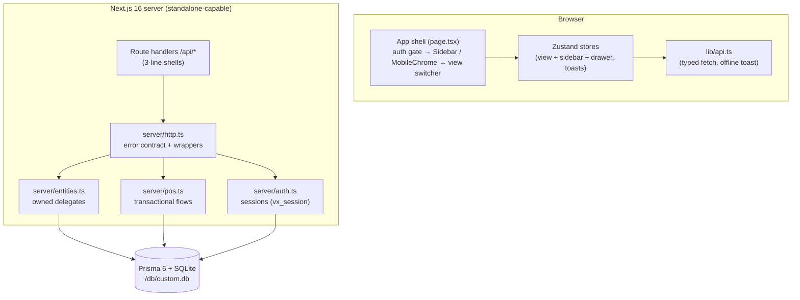

# Project Architecture Document — VeloxPOS

**Version:** 1.0.0 · **Date:** 2026-10-26 · **Status:** the pivot release
(the Omni-Study1 codebase repurposed as the VeloxPOS clone; scaffolding
reused, domain rebuilt)

---

## Table of Contents

1. [System Overview & Decisions](#1-system-overview--decisions)
2. [High-Level System Topology](#2-high-level-system-topology)
3. [Application Architecture](#3-application-architecture)
4. [Data Architecture](#4-data-architecture)
5. [Design System Reference](#5-design-system-reference)
6. [Security Architecture](#6-security-architecture)
7. [Testing Strategy](#7-testing-strategy)
8. [Build & Deployment](#8-build--deployment)
9. [Developer Handbook](#9-developer-handbook)
10. [Known Issues & Outstanding Tasks](#10-known-issues--outstanding-tasks)

---

## 1. System Overview & Decisions

VeloxPOS is a single Next.js application that clones the hosted
`veloxposen.base44.app` point-of-sale workspace as an open, self-hosted
superset. One page renders the whole authenticated app; eight PascalCase
paths (`/Terminal`, `/Dashboard`, `/Inventory`, `/Sales`, `/Registers`,
`/Cashiers`, `/Reports`, `/Settings`) are rewrites onto it, mirroring the
reference's URL structure while the view state rides a Zustand store synced
with `location.pathname` (popstate wired — deep links and back/forward
work).

### The decision ledger (ADR summary)

| ADR | Decision | Rationale |
|---|---|---|
| ADR-001 | Reuse the cloned repo's infra (auth, db seam, HTTP seam, UI kit, configs); rebuild the domain | The prompt names the repo as scaffolding; the proven seams carry test and security history |
| ADR-002 | SPA-with-rewrites (one page) instead of 8 routes | Byte-parity with the reference's URL structure; the shell's auth gate renders once; measured reference behavior |
| ADR-003 | Integer-cents money (`*Cents` Int columns, Zod `moneyInput` boundary) | Float money is the documented anti-pattern — the reference itself displayed a 1.7999999523162842 artifact |
| ADR-004 | One transaction per checkout (stock `updateMany` guard + ticket + items) | A physical drawer cannot sell stock that is not there; partial tickets are worse than failed tickets |
| ADR-005 | Shift-gated selling (one open shift per register) | Matches the reference's "No active shift" gate; gives Reports a shift boundary and Cashiers its "Turnos Recientes" |
| ADR-006 | Ownership-scoped CRUD delegates (`makeCollectionRoutes`/`makeItemRoutes`) | Every query carries `where: { userId }` by construction; routes stay 3-line shells |
| ADR-007 | Working CRUD where the reference is broken (F10) + a real Settings page where it 404s (F11) | "Production-ready functional superset" is the contract; replicating a broken button ships a defect |
| ADR-008 | Working mobile drawer (the reference crushes its desktop layout at 390px — F13) | Explicit user requirement; built on the repo Tailwind v4 skill's mobile-nav contract |
| ADR-009 | Reference-verbatim copy (Spanish Sales/Cashiers, English elsewhere) | Visual parity is the goal; an i18n layer is a superset later, not a parity substitute |
| ADR-010 | Dark-only theme (no theme store) | The reference has no theme toggle; the measured design IS dark |
| ADR-011 | Self-hosted auth without SMTP: verification codes and reset links surface to the actor | No email provider in scope; the routes' responses ARE the delivery (inherited from the scaffolding's ADR-013) |
| ADR-012 | Social buttons render for parity, activation toasts "not configured" | No fake UI; honest failure over pretend success |
| ADR-013 | Empty demo seed (parity states) + `db:seed:sample` for a populated store | Screenshot parity against the reference's zero states AND demo-ability |

## 2. High-Level System Topology



Single-process, single-file database. No workers, no queues, no external
services — the AI/telemetry layers of the previous tenant were removed with
the study domain (they were study-app supersets, not reference features).

## 3. Application Architecture

### 3.1 The shell (`src/app/page.tsx`)

- Boot: `hydrate()` syncs the view from the URL → `GET /api/auth/me`
  (401 → full reload to `/login`) → render. The splash covers the gate.
- `data-app-hydrated` on `<html>` is the e2e's shell-rendered gate.
- Chrome: `Sidebar` (`lg+`, 220px / 68px collapsed), `MobileChrome`
  (`<lg` app bar + drawer), `ConnectivityBanner` (offline pill), skip link.
- The active view mounts from `VIEW_COMPONENTS` — each view owns its data
  loading (async IIFE, `cancelled` flag, setState after await boundaries —
  the `react-hooks/set-state-in-effect` gate).

### 3.2 The views (`src/components/views/`)

| View | Data | Notes |
|---|---|---|
| `terminal-view` | products + shifts, then sales on checkout | Shift-gated stage; cart state machine (`lib/cart.ts`); checkout dialog (method/customer/cash+change); printable receipt |
| `dashboard-view` | `/api/dashboard/summary` (one fetch) | 4 stat cards, 7-day area chart, category bars, low-stock strip |
| `inventory-view` | products + categories | Measured table + dialog; search/category filter; delete confirm |
| `sales-view` | `/api/sales` | Spanish copy; detail dialog; refund (restores stock) |
| `registers-view` | registers + shifts | Cards with live status; open/close shift dialogs; recent shifts |
| `cashiers-view` | `/api/cashiers` + shifts (admin-only) | User cards + "Turnos Recientes" table; create/deactivate/delete |
| `reports-view` | `/api/reports/summary?days=` | Period chips; daily chart; method donut + breakdown; CSV export |
| `settings-view` | settings + categories + me | Three tabs: Store profile / Categories manager / Account + password |

### 3.3 The pure seams (unit-tested, no I/O)

- `lib/money.ts` — cents math, formatting, per-line tax (half-up).
- `lib/cart.ts` — the cart state machine + totals + change + tender
  suggestion + barcode parsing.
- `lib/reports.ts` — daily series (local-day bucketing), method breakdown,
  period stats, low-stock rule, category counts, CSV.
- `lib/router.ts` — the 8-view ↔ path map + the dashboard date label.
- `lib/validation.ts` — every payload contract (Zod, strip mode).
- `lib/db-path.ts` — the `file:../db/custom.db` → `<repo>/db/custom.db`
  resolution contract.
- `lib/auth.ts` — scrypt hashing, HMAC session tokens, rate limiter.

### 3.4 Mobile navigation (`components/layout/mobile-chrome.tsx`)

The reference has no working mobile nav (F13). The clone's drawer: a real
`<button>` trigger (`aria-expanded`/`aria-controls`), `role=dialog` +
`aria-modal`, focus moves in on open and returns to the trigger on close,
Tab cycles inside (trap), Escape and backdrop-tap close, body scroll locks,
and the drawer closes when the viewport crosses into `lg`. Tailwind v4
traps honored: `flex flex-col gap-1` nav (never `space-y-*` with margin
children), `backdrop-blur-xs`, CSS-class gradients. Pinned by
`tests/e2e/mobile-navigation.spec.ts` at 390×844 + 768×1024 + 1280×800.

## 4. Data Architecture

Prisma + SQLite, schema at `prisma/schema.prisma`, file at `<repo>/db/custom.db`
(gitignored; `db:push` + `db:seed` recreate).

| Model | Purpose | Key fields |
|---|---|---|
| `User` | auth + role | email (unique), passwordHash, role (`admin`/`cashier`), phone, active, emailVerified |
| `Category` | product grouping | userId+name unique, color |
| `Product` | catalog | userId+barcode unique, categoryId (SetNull), priceCents, costCents, stock, minStock, taxRate, unit, active |
| `Register` | cash drawer | userId+name unique, location |
| `Shift` | register session | registerId, openedAt/closedAt, openingFloatCents, expectedCashCents, closingCashCents, status |
| `Sale` | ticket header | userId+ticketNo unique, registerId, shiftId, method, status, subtotal/tax/discount/total/paid/change (cents), customerName |
| `SaleItem` | ticket lines | saleId, productId (SetNull), name/priceCents/qty/taxRate/lineTotalCents (snapshots — survive product deletion) |
| `StoreSetting` | singleton per user | storeName, address, phone, currency, receiptFooter, defaultTaxRate |
| `VerificationToken` / `PasswordResetToken` | email flows | code/token (reset token unique), expiry, one-shot |

Delete semantics: user-owned rows cascade with the user (a cashier's shifts
and sales cascade); optional references SetNull. Money columns are Int
cents throughout (ADR-003). Ticket numbers allocate as
`#T{count+1, 6-digit padded}` inside the checkout transaction.

## 5. Design System Reference

All values measured live from the reference (plan §0); tokens live in
`src/app/globals.css` (`@theme` literals + `:root` RGB triplets + semantic
classes).

| Token | Value | Where |
|---|---|---|
| Canvas | `#080a14` | body |
| Surface (sidebar) | `#0d0f1a`, border `#1e2235` | `aside` |
| Card | `rgba(16,18,32,0.9)`, border `white/7%`, radius 16px | `.vx-card` |
| Primary gradient | 135° `#7c3aed → #6366f1`, glow `rgba(124,58,237,.4) 0 4px 20px` | `.vx-gradient` + `.vx-glow` |
| Charge gradient | 135° `#059669 → #10b981` (disabled: opacity .5) | `.vx-charge-gradient` |
| Active nav | bg `rgba(124,58,237,.2)`, text `#c4b5fd`, radius 12px, 14px/500, h-42 | `.vx-nav-active` |
| Chart accent | violet-400 `#a78bfa`, 2px; dashed grid `white/25` | `components/pos/charts.tsx` |
| Page title | 24px/700, `rgb(30 41 59)` (slate-700 — reference parity quirk) | `.vx-page-title` |
| Table headers | 11px uppercase tracking-wide `white/40` | `.vx-table-header` |
| Inputs | bg `#141830`, border `#1e2235`, violet focus ring | `.vx-input` / `.vx-focusable` |

Typography: system sans (the reference's own stack); the brand wordmark is
18px/800. Icons: lucide-react (Terminal=ShoppingCart, Dashboard=ChartColumn,
Inventory=Package, Sales=History, Registers=Monitor, Cashiers=Users,
Reports=FileText, Settings=Settings, brand=Zap).

## 6. Security Architecture

- **Passwords**: scrypt with per-hash salt (`lib/auth.ts`); hashes never
  leave the server (no select includes them; `publicUser`/`publicCashier`
  shape every response).
- **Sessions**: HMAC-signed tokens in an httpOnly, sameSite=lax cookie
  (`vx_session`), 7-day TTL, `secure` rides the request protocol. The boot
  guard (`instrumentation.ts` + `lib/env-check.ts`) refuses production boot
  without a real `AUTH_SECRET`.
- **Rate limits**: login/register/forgot/change-* 10–20 per 15 min per IP
  (in-memory limiter; documented single-instance scope). Successful login
  resets the counter.
- **Input**: every body passes Zod (`parseWith`); unknown keys stripped.
- **Ownership**: every delegate query carries `userId`; item routes
  re-verify ownership before mutating (404 on foreign ids).
- **Money integrity**: checkout is one transaction; stock decrements are
  conditional (`updateMany … stock >= qty`, count mismatch → rollback); the
  cash-tender check rejects underpayment for cash sales.
- **Admin surface**: `/api/cashiers*` requires `role === "admin"`
  (`assertAdmin`); self-deactivation/self-deletion blocked (lockout guard).
- **No secrets in the tree**: `.env` gitignored; pushes carry the key via
  the SSH wrapper (key materialized outside the repo, shredded after).

## 7. Testing Strategy

Two layers, no overlap (vitest matches `tests/**/*.test.ts`; playwright
takes `tests/e2e/*.spec.ts`):

- **Unit (Vitest, 65 checks)** — the pure seams: money, cart, reports,
  router, validation schemas, db-path, auth. No DB, no React, deterministic
  (local-day bucketing tested against fixed dates).
- **E2E (Playwright, 44 checks)** — the production standalone server on
  :3100 with an isolated `db/e2e.db` (global-setup pushes + seeds). The
  "setup" project signs the demo user in once → storageState (the auth
  limiter makes per-test logins impossible). Specs:
  `auth` (logged-out surface, inline errors, sign-in),
  `navigation` (sidebar, SPA switching, deep links, collapse, 404),
  `mobile-navigation` (the drawer contract at three viewports),
  `terminal` (gate + full cash sale + barcode guard),
  `inventory` (CRUD through the dialog),
  `registers` (create → open shift → Terminal unlock → close → delete),
  `data-views` (dashboard/sales+refund/cashiers),
  `settings` (tabs, persistence, category round-trip).

Specs are self-cleaning (unique `${Date.now()}` names, afterAll cleanup) and
the terminal spec normalizes the shift state before asserting the gate.

## 8. Build & Deployment

- `bun run build` → `next build` (standalone output) + copies
  `.next/static` and `public/` into `.next/standalone` →
  `.next/standalone/server.js` runs anywhere with `bun` (or Node ≥ 20 via
  the traced server).
- Docker: multi-stage `Dockerfile` (prod-deps → build → bun runtime) +
  `docker-compose.yml` (SQLite volume, `AUTH_SECRET` required, `init`
  profile for push+seed, healthcheck on `/api/health`). `docs/DEPLOYMENT.md`
  is the full runbook.
- Boot guard: production refuses to start without a real `AUTH_SECRET`
  (`openssl rand -hex 32`).
- Push: `docs/ssh_git_wrapper_v3.py` (main-only, post-push verification,
  paramiko shim for OpenSSH-less sandboxes).

## 9. Developer Handbook

See `AGENTS.md` (commands, traps, seams) and `CLAUDE.md` (boot sequence,
debugging playbook). The short version for a fresh checkout:

```bash
bun install
cp .env.example .env        # DATABASE_URL="file:../db/custom.db"
bun run db:push && bun run db:seed
bun run dev                 # demo@veloxpos.app / Demo1234!
```

## 10. Known Issues & Outstanding Tasks

- **Reference drift**: the reference is a live app; re-measure before any
  parity dispute (the findings ledger in
  `docs/veloxpos-implementation-plan.md` §0 is the baseline, dated
  2026-10-26).
- **Dark-on-dark page titles** (slate-700 on #080a14, ~1.4:1) are reference
  parity. If contrast standards ever outrank parity, flip `.vx-page-title`
  to a lighter token — one line, all views.
- **Barcode field**: accepts scanner input (Enter submits) but there is no
  camera-scan mode; a getUserMedia barcode scanner would be the natural
  superset.
- **Rate limiter is in-memory** — multi-instance deployments need a shared
  store (documented scope: single-instance self-hosting).
- **No hosted CI** — the local gate is the only gate; keep it green.
- **The reference's write flows may be transiently broken** (hosted quota?)
  — if they come back online, re-verify the populated reference states
  against the clone's dialogs.
