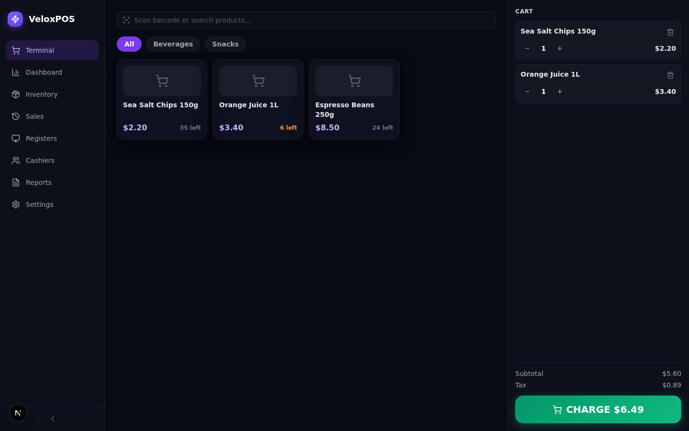
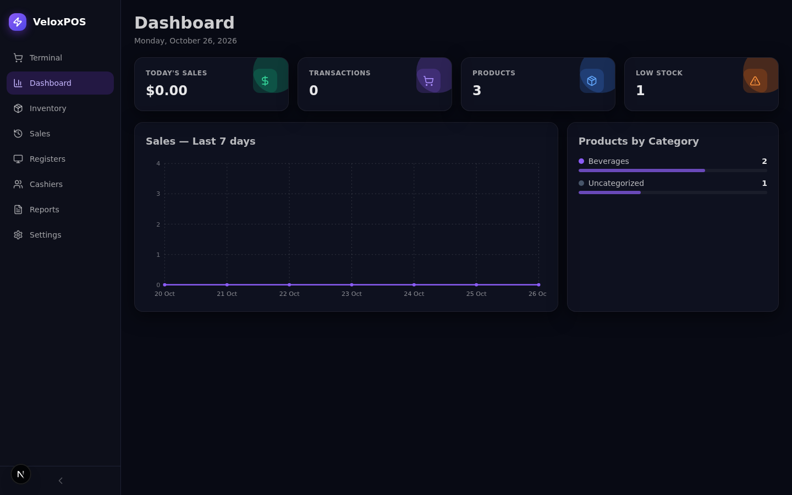
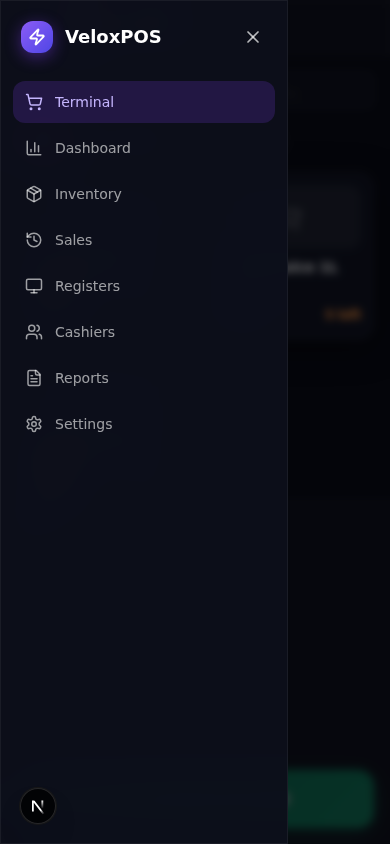

# VeloxPOS (Point Of Sale)


**A production-ready, enterprise-grade Point of Sale web application — a functional superset of
`veloxposen.base44.app` with measured visual parity, built on Next.js 16 + React 19 + Prisma/SQLite.**

---

## Overview

VeloxPOS runs the whole counter workflow: cash registers with shift management, a barcode-first
selling terminal with a live cart, inventory with low-stock tracking, cashier accounts, and sales
analytics with period filtering. Every surface is server-gated, Zod-validated, and covered by a
local verification gate (lint → typecheck → unit → build → e2e) — the local gate is the only gate.

The application replicates the reference POS (`veloxposen.base44.app`) view-for-view — the same
routes, the same dark glass design system, the same mixed English/Spanish copy — and extends it
where the reference's demo account is write-restricted: full CRUD everywhere, shift close with
cash-count variance, cash checkout with change, printable receipts, CSV import/export, and a
working mobile navigation drawer (the reference keeps a broken phone layout: a static 220px
sidebar squeezing main to 170px at 390px, no hamburger).

## Screenshots

| | |
|---|---|
|  |  |
| Login — the reference's light card | Terminal — catalog, cart, and CHARGE |
|  |  |
| Dashboard — stat cards + charts | Mobile navigation drawer (390×844) |

## Key Features

| Feature | Description |
|---|---|
| 🖥️ Terminal | Shift-gated selling surface: barcode/name search, category chips, product grid, live cart with quantity controls, cash/card checkout with change computation, printable receipt |
| 📊 Dashboard | Today's sales, transactions, product count, low-stock alerts; a 7-day sales line chart and a products-by-category breakdown — all computed by pure, unit-tested seams |
| 📦 Inventory | Product CRUD with barcode, category, unit, tax rate, min-stock thresholds; live search; CSV export + import; stock status chips (In stock / Low / Out) |
| 💵 Registers | Cash-register management; open/close shift lifecycle with opening float, expected-cash computation, and counted-cash variance (Over/Short/Exact) |
| 🧾 Sales | Spanish-copy sales ledger (Historial de Ventas) with ticket search by ticket/customer/cashier and a per-sale receipt viewer |
| 👥 Cashiers | Cashier account management (role-scoped users) with the Spanish Turnos Recientes shift ledger |
| 📈 Reports | 7/14/30/90-day period pills; total revenue, transactions, average ticket; daily-sales area chart; revenue by payment method |
| ⚙️ Store Settings | Business information, branding colors, receipt footer, fiscal/tax data with receipt-visibility control, card payment provider, product categories |
| 🔐 Auth | Email/password sign-in (scrypt + HMAC httpOnly cookies), registration, email verification, password reset, rate-limited public endpoints |
| 📱 Mobile drawer | The documented a11y superset: labeled hamburger, slide-in drawer (role=dialog, focus-trapped, animated), backdrop/Escape/route-change close, focus restore to the trigger, md-growth auto-close, zero horizontal overflow at 390px |

## Quick Start

**Prerequisites:** [Bun](https://bun.sh) ≥ 1.1, Node.js ≥ 20 (for Playwright), Chromium for e2e.

```bash
# 1. Install dependencies
bun install

# 2. Configure the environment (see the table below)
cp .env.example .env        # then set AUTH_SECRET (openssl rand -hex 32)

# 3. Provision the database — db/custom.db at the repo root
bun run db:push
bun run db:seed

# 4. Start the dev server
bun run dev                 # → http://localhost:3000
```

**Verify setup:**

```bash
curl http://localhost:3000/api/health
# {"status":"ok","db":"up","app":"veloxpos"}
```

Sign in with the seeded owner account: `sepnetflix2023@outlook.com` / `$Abcd1234`.
Optionally populate a showcase dataset: `bun run db:seed -- --demo` (categories, 15 products, a
register, a closed shift, and a week of sales).

## Environment Variables

| Variable | Required | Description |
|---|---|---|
| `DATABASE_URL` | ✅ | `file:../db/custom.db` (the documented dev default — resolves against `prisma/schema.prisma` for the CLI **and** the runtime via `src/lib/db-path.ts`). Use an **absolute** `file:` URL for production/standalone deploys. |
| `AUTH_SECRET` | ✅ (prod, fatal at boot) | HMAC session-signing secret. Generate with `openssl rand -hex 32`. Production refuses to boot without a real secret; dev falls back to an insecure constant with a warning. |
| `NEXT_PUBLIC_SITE_URL` | — | Canonical origin for metadata/sitemap/robots (`http://localhost:3000` in dev). |
| `COOKIE_SECURE` | — | Set `false` only for plain-HTTP production deployments (the e2e standalone server uses it; browsers drop Secure cookies over non-HTTPS origins). |

## Scripts

| Command | What it does |
|---|---|
| `bun run dev` | Dev server on :3000 (output teed to `dev.log`) |
| `bun run build` | Standalone production build (`next build` + static/public copy) |
| `bun run lint` | ESLint (flat config) |
| `bun run typecheck` | `tsc --noEmit` (strict) |
| `bun run test` | Vitest unit suite — the pure domain seams (151 tests / 15 files) |
| `bun run test:e2e` | Playwright suite against the production standalone build (117 tests; desktop 1440×900 + mobile 390×844 projects, plus the four-width 390/768/1024/1440 drift-sweep battery, the with-data Reports + Dashboard + Inventory-CSV + fiscal-receipt walks, and the password-reset round-trip) |
| `bun run smoke` | The 13-step API smoke ladder against the standalone artifact on :3210 (own scratch `db/smoke.db`; health → auth wall → Zod seam → CRUD → rate limit → boot gate → artifact hygiene) |
| `bun run gate` | The full pre-push gate: `lint → typecheck → test → build → smoke → e2e` |
| `bun run db:push` | `prisma db push` against `db/custom.db` |
| `bun run db:seed` | Idempotent owner + default store settings (`-- --demo` adds showcase data) |

## Architecture

| Layer | Technology | Purpose |
|---|---|---|
| Framework | Next.js 16 (App Router, standalone output) | Server-gated routes at the reference's real paths |
| UI runtime | React 19 | Client views; ONE Zustand store (`usePosStore`) |
| Styling | Tailwind CSS v4 (CSS-first, no config file) | Pinned palette + the measured `glass-*` classes |
| Primitives | Radix UI (shadcn-style components in `src/components/ui`) | Dialogs, selects, switches (the toaster is zustand-based — no Radix toast) |
| ORM | Prisma 6 / SQLite (`db/custom.db`) | 9 models, all ownership-scoped |
| Auth | scrypt + HMAC httpOnly cookie (`sf_session`) | Boot-guarded secret, rate-limited public endpoints |
| Validation | Zod 4 at every API boundary | Nothing reaches Prisma unvalidated |
| Charts | Hand-rolled SVG (`src/components/pos/shared.tsx` + the `smoothPath`/`niceScale` seams) | Zero chart dependencies; the two measured chart families |

```
Browser ──► /POS /Dashboard /Inventory /Sales /Registers /Cashiers /Reports /StoreSettings
              │ (server-gated layout: session or redirect to /login)
              ▼
        Client views (usePosStore) ──► /api/* (Zod → delegates → Prisma)
                                          │
              ┌───────────────────────────┼──────────────────────────┐
              ▼                           ▼                          ▼
        /api/auth/* (scrypt+HMAC)   /api/products|categories|   /api/shifts|sales (workflows:
        rate-limited, cookie ttl    registers|cashiers (CRUD     open/close shift, checkout
                                    factories + ownership)       with server-side totals)
```

**Directory map (key files):**

```
📂 src
 ├ 📂 app
 │  ├ 📂 (app)/          — the 8 server-gated routes (POS, Dashboard, …, StoreSettings)
 │  ├ 📂 api/            — auth, products, categories, registers, shifts, sales, cashiers, store-settings, health
 │  ├ 📄 layout.tsx      — root layout (dark canvas + Toaster)
 │  ├ 📄 not-found.tsx   — the reference's Spanish 404
 │  └ 🎨 globals.css     — Tailwind v4 @theme pins + tokens.css import
 ├ 📂 components
 │  ├ 📂 pos/            — AppShell (sidebar + mobile drawer), views, login/reset surfaces
 │  └ 📂 ui/             — shadcn-style primitives
 ├ 📂 lib
 │  ├ 💰 money.ts        — cents-safe money math (the ONLY place amounts are computed)
 │  ├ 🛒 cart.ts         — cart reducer + totals + the charge gate
 │  ├ 🧾 shift.ts        — shift state machine (expected cash, variance)
 │  ├ 📈 reports.ts      — period bucketing + aggregations
 │  ├ 📦 inventory-status.ts — stock derivation + the CSV round-trip
 │  ├ 🗺️ router.ts       — the route↔nav map (unit-pinned)
 │  ├ ✅ validation.ts   — every Zod contract
 │  ├ 🗄️ db.ts/db-path.ts — the documented DATABASE_URL resolution contract
 │  └ 🌐 store.ts        — the ONE Zustand store
 └ 📂 lib/server         — http.ts (error mapper + CRUD factories), auth.ts (cookies), entities.ts
📂 prisma                — schema.prisma (9 models) + seed.ts
📂 tests
 ├ 📂 unit/              — 15 vitest files over the pure seams
 └ 📂 e2e/               — Playwright specs (desktop + mobile projects)
```

## API Reference

All endpoints return domain JSON; errors use `{ error: string }` with the documented status mapping
(Zod → 400, P2002 → 409, P2025 → 404, unauthed → 401). Authenticated endpoints require the
`sf_session` cookie.

| Endpoint | Methods | Auth | Description |
|---|---|---|---|
| `/api/auth/login` | POST | public (rate-limited) | Credential exchange; sets the session cookie |
| `/api/auth/register` | POST | public (rate-limited) | Owner account creation |
| `/api/auth/forgot-password` · `/reset-password` | POST | public (rate-limited) | One-shot 48-hex reset tokens |
| `/api/auth/me` · `/logout` | GET · POST | ✅ | Session introspection / logout |
| `/api/products` · `/api/products/[id]` | GET · POST · PATCH · DELETE ⚠️ | ✅ | Inventory CRUD |
| `/api/categories` · `/[id]` | GET · POST · PATCH · DELETE ⚠️ | ✅ | Category CRUD |
| `/api/registers` · `/[id]` | GET · POST · PATCH · DELETE ⚠️ | ✅ | Register CRUD (delete refused with shift history) |
| `/api/shifts` | GET · POST | ✅ | Shift ledger + open-shift workflow (one active per register) |
| `/api/shifts/[id]` | PATCH | ✅ | Close shift: counted cash in → expected/variance computed server-side |
| `/api/sales` | GET · POST | ✅ | Ledger + checkout (server-authoritative totals, stock decrement, ticket allocation) |
| `/api/sales/[id]` | GET · PATCH | ✅ | Receipt payload / refund flip |
| `/api/cashiers` · `/[id]` | GET · POST · PATCH · DELETE ⚠️ | ✅ (owner) | Cashier account management |
| `/api/store-settings` | GET · PATCH | ✅ | Lazy-materialized store settings |
| `/api/health` | GET | public | `{status, db, app}` liveness |

## Testing

```bash
bun run test            # unit: 151 tests / 15 files — the pure seams (money, cart, shift,
                        # reports, inventory-status, currency, router, validation, auth,
                        # db-path, env-check, site, store, chart-path) + the docs-counts lockstep gate
bun run test:e2e        # e2e: 117 tests — needs `bun run build` first (boots the standalone
                        # build on :3100 with its own scratch db, db/e2e.db)
bun run smoke           # the 13-step API smoke ladder — also needs the build (boots the
                        # artifact on :3210 with db/smoke.db; verifies the boot gate +
                        # artifact hygiene on every run)
bun run gate            # the one-command pre-push gate: lint → typecheck → unit → build
                        # → smoke → e2e
```

The e2e suite runs two projects: **desktop** (1440×900) and **mobile** (390×844, the
`mobile-navigation.spec.ts` drawer suite). Auth is established once per run (`auth.setup.ts`,
storageState reuse) to respect the 10/IP/15-minute rate limit. The scratch db is provisioned by the
webServer command itself (kill-port → provision → boot) and never replaced while the server lives.
The Session-20 drift-sweep tier (`viewport-drift-sweep.spec.ts`) pins the responsive frame at all
four audit widths — 390/768/1024/1440 — across every route (zero horizontal overflow + the
chrome-switch contract), and the with-data ledger containment at 390 on all THREE ledger
surfaces — Inventory, Sales, Cashiers — (the functional-scroll guard, extended in Session-21).
The Session-22 with-data Reports walk (`with-data-reports-walk.spec.ts`) pins the computed
surface end-to-end — the stats, both method tables, and the chart domain asserted EXACTLY
against values derived from the API's own sales response at runtime — plus the with-data
containment at 390 (it sorts last in the suite because it persists sales). The Session-23
with-data Dashboard walk (`with-data-dashboard-walk.spec.ts`) pins the app's landing view the
same way — the today/stats testids, the category-breakdown rows and share bars, and the chart's
niceScale domain all asserted against values derived from the sales/products/categories APIs
at runtime — plus the with-data containment at the remaining widths (768/1024/390). The
Session-24 with-data Inventory CSV round-trip walk (`with-data-inventory-csv.spec.ts`) pins
the superset feature end-to-end — the import (the file input → the per-row POSTs → the store
upserts → the ledger re-render → the "Import complete" toast), the export (the download's
`products.csv` content: the header byte-exact, both fixture lines byte-exact with the
category-NAME resolution, and the API-derived line count), and the error path (a blank-name
row → "Import failed: name is required", zero rows imported). The Session-25 with-data
fiscal receipt round-trip walk (`with-data-fiscal-receipt-walk.spec.ts`) pins the deepest
StoreSettings chain end-to-end — the fiscal switch flip (the inverted wiring, live) → the
RUC/regime fills → Save → the API-persisted state → a real terminal checkout → the receipt's
fiscal line asserted by its EXACT template text in the visible state, and gated to render
NOTHING in the hidden-polarity state (the RUC still set, the flag off) — with the settings
restored to seed defaults at the end. The Session-26 password-reset round-trip (2 tests in
`auth.spec.ts`) pins the auth surface's deepest unpinned chain — the REAL one-shot token
lifecycle the fabricated-token pins could never see: register → verify-email → forgot →
the 48-hex `resetPath` → the reset page's "Password Updated" done state → the NEW
password signing in through the real form (the old one dead at 401), and the consumed
token rejecting replays (the one-shot `usedAt` consumption riding the same transaction
as the password write).

## Design System

The measured reference tokens (extracted live via computed styles — see
`docs/veloxpos-implementation-plan.md` §0):

| Token | Value | Usage |
|---|---|---|
| Canvas | `#080a14` | App background |
| Panel | `#0d0f1a` | Sidebar + cart panel |
| Panel raised | `rgba(16,18,32,0.9)` | `.glass-card` surfaces |
| Edge | `#1e2235` | Borders |
| Active nav | `rgba(124,58,237,0.2)` + `#c4b5fd` | The violet pill |
| Charge gradient | `135° #059669 → #10b981` | `.glass-button-success` |
| Brand gradient | `to bottom right #8b5cf6 → #4f46e5` | The logo chip |

Typography: the system stack (`ui-sans-serif, system-ui`) — no webfonts. The `glass-*` family is
plain CSS in `src/app/tokens.css` (never `@layer utilities` — the documented Tailwind v4 cascade
trap). `tw-animate-css` powers the Radix `data-[state]` dialog animations, and
`@custom-variant hover (&:hover)` restores the reference's touch-device hover semantics. The
login route scopes `.theme-light` for its light card.

## Deployment

The production artifact is the standalone build (see `docs/DEPLOYMENT.md` for the full runbook):

```bash
bun run build
DATABASE_URL="file:/absolute/path/db/custom.db" AUTH_SECRET=$(openssl rand -hex 32) \
  PORT=3000 bun .next/standalone/server.js
```

Use an **absolute** `DATABASE_URL` in production (the dev-relative form is anchored per-bundle —
see the contract in `src/lib/db-path.ts`). `AUTH_SECRET` is enforced at boot in production
(`src/instrumentation.ts` exits loudly when missing/weak).

## Documentation

- `docs/veloxpos-implementation-plan.md` — the measured reference spec + the build plan
- `Project_Architecture_Document.md` — the full engineering reference (ADRs, data model, invariants)
- `AGENTS.md` / `CLAUDE.md` — agent conventions (commands, traps, seams)
- `docs/Tailwind-V4-Validation-Report.md` — the ten documented v3→v4 traps this codebase pins
- `docs/how-to-git-push-using-ssh-wrapper_SKILL.md` — the SSH push runbook (`docs/ssh_git_wrapper_v3.py`)

## License

Proprietary — internal engineering reference. All rights reserved.
