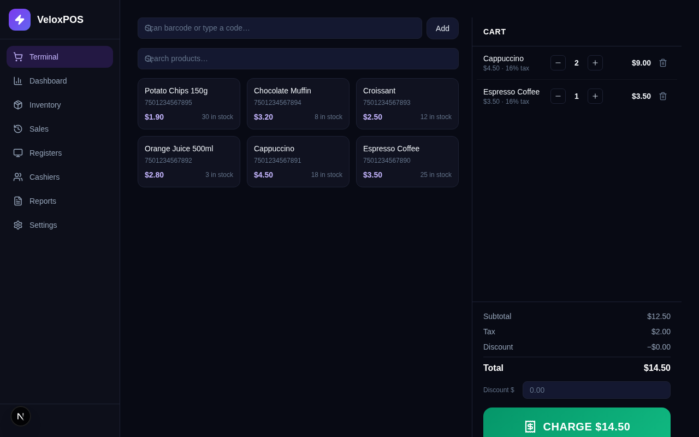
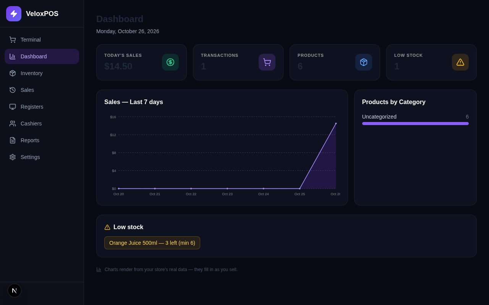
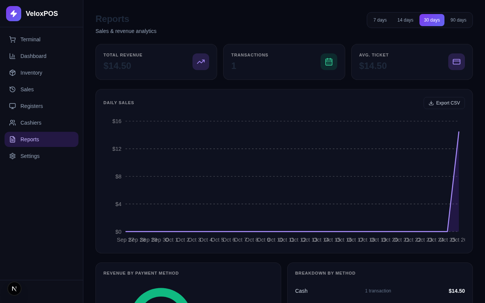
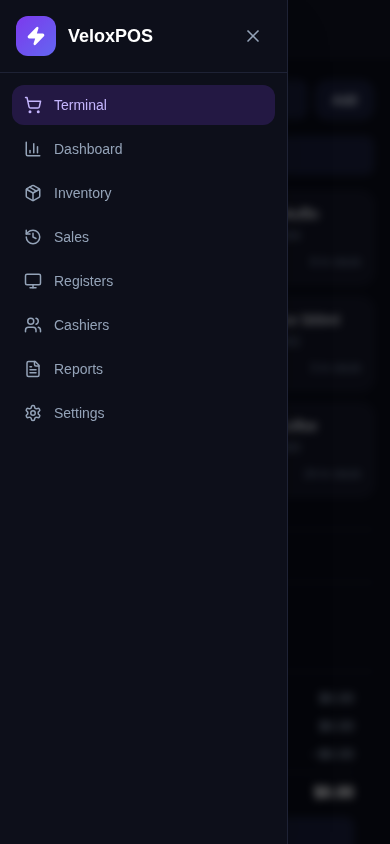
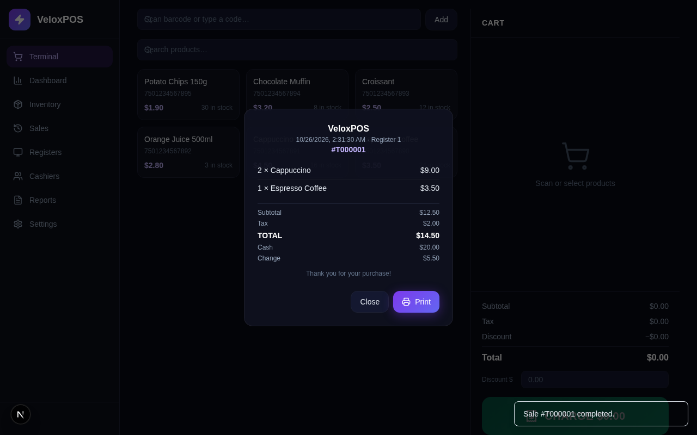
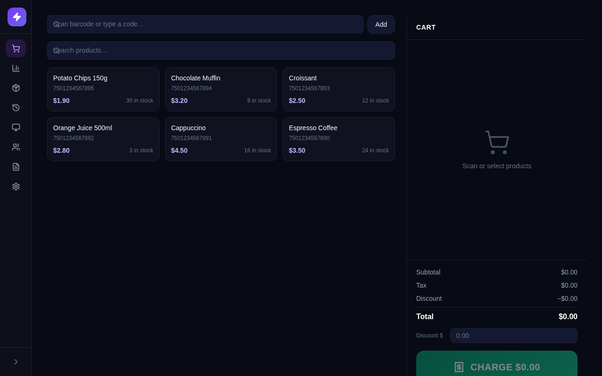
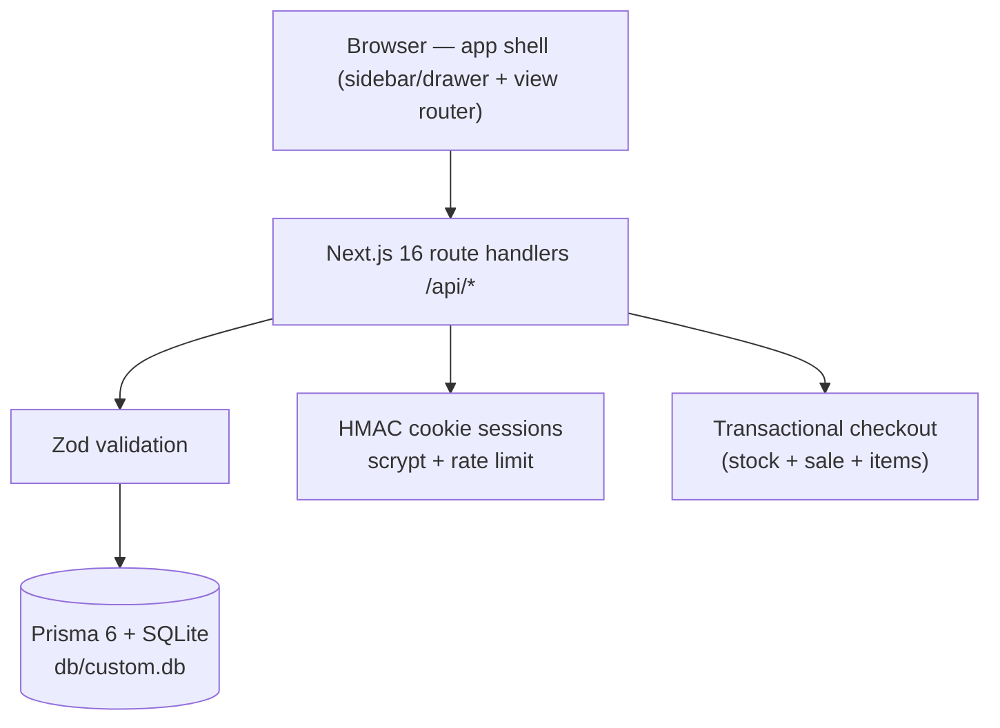

# VeloxPOS (Point Of Sale)

     

**VeloxPOS — a fast, self-hosted point of sale.** A production-ready clone
(functional superset) of the [`veloxposen.base44.app`](https://veloxposen.base44.app/)
POS app, rebuilt as a single Next.js application you fully own: your database,
your data, your deployment.

## Overview

The reference is a dark-themed point-of-sale workspace — terminal, inventory,
registers, cashiers, and reports — that lives behind a hosted platform login
with no source access. VeloxPOS rebuilds every surface as an open codebase.
Visual parity was measured from the live reference (computed styles and
pixel-level screenshots, not eyeballing — see
`docs/veloxpos-implementation-plan.md` §0 for the evidence table). Where the
reference is broken or unfinished, VeloxPOS ships working features: the
reference's product/register create-flows never complete and its Settings
link renders a 404 — every one of those surfaces works here.

| | | |
|---|---|---|
|  |  |  |
|  |  |  |

All captures above live in [`docs/screenshots/`](docs/screenshots/) — desktop
views, the dialogs, the receipt, the 404 surface, the collapsed rail, and the
mobile set (390×844) including the working navigation drawer.

## Key Features

| Feature | What it does |
|---|---------|
| 🛒 Terminal | Barcode/scan input + product grid, cart with qty controls and discounts, cash/card/transfer checkout with change math, printable receipt, shift-gated selling ("No active shift" state mirrors the reference) |
| 📊 Dashboard | Long-date header, the four reference stat cards (TODAY'S SALES / TRANSACTIONS / PRODUCTS / LOW STOCK), the "Sales — Last 7 days" violet area chart, "Products by Category", plus a low-stock alert strip |
| 📦 Inventory | Reference-measured table (PRODUCT/CODE/PRICE/STOCK/CATEGORY/STATUS/ACTIONS), search by name or code, category filter, full create/edit/delete through the measured New Product dialog (Name, Barcode, Category, Selling price, Cost, Current stock, Min. stock, Tax rate 16%, Unit, Active switch) |
| 🧾 Sales | "Historial de Ventas" with the reference's Spanish copy, search by ticket/customer/cashier, receipt detail dialog, refunds that restore stock |
| 🖥️ Registers | Cash-register cards with live shift status, the measured New Register dialog, open-shift float capture, close-shift cash counting with expected-vs-counted comparison |
| 👥 Cashiers | "Cajeros" user administration (admin-only), roles, activate/deactivate, "Turnos Recientes" table |
| 📈 Reports | Period chips (7/14/30/90 days), TOTAL REVENUE / TRANSACTIONS / AVG. TICKET cards, DAILY SALES chart, REVENUE BY PAYMENT METHOD donut + BREAKDOWN BY METHOD, CSV export |
| ⚙️ Settings | The reference's Settings link 404s — this page exists: store profile (name/address/currency/tax/receipt footer), the Categories manager, account profile + password change |
| 🔐 Auth | The reference's hosted login layout ("Welcome to VeloxPOS (Point Of Sale)", the four social buttons, email+password) backed by a real self-hosted flow: scrypt+HMAC cookie sessions, rate limiting, email verification, forgot/reset |
| 📱 Mobile navigation | The reference has NO working mobile nav (its desktop layout crushes at 390px) — the clone ships a full drawer: hamburger app bar, focus-trapped `role=dialog`, Esc/backdrop close, scroll lock, drawer→view navigation |
| ♿ Accessibility | Skip link, violet focus-visible rings on every interactive element, `aria-current` nav, `prefers-reduced-motion` drawer, polite live-region toasts, WCAG-minded contrast on the surfaces the reference left unreadable |
| 🛡️ Resilience | Offline banner (ambient, renders nothing while online), transport failures toast human messages, Zod validation at every API boundary, one-transaction checkout (stock decrement + ticket + items commit or roll back together) |
| 🐳 Docker | Multi-stage `Dockerfile` + compose with a SQLite volume — one command from clone to container |

## Architecture

| Layer | Technology | Version | Purpose |
|-------|-----------|---------|---------|
| Framework | Next.js (App Router) | 16.4 | One page + 8 path rewrites (SPA parity with the reference) |
| UI runtime | React | 19 | Client view switching inside a single app shell |
| Language | TypeScript | 5 (strict) | End-to-end types, no `any` |
| Styling | Tailwind CSS | 4 (CSS-first `@theme`) | Measured dark tokens (`docs/veloxpos-implementation-plan.md` §0) |
| Components | Radix UI (shadcn-style) | current | Accessible primitives |
| Database | SQLite via Prisma ORM | 6.19 | Zero-config, single file at repo-root `db/` |
| State | Zustand | 5 | App store + toast store; URL is the routing truth |
| Validation | Zod | 4 | Every API boundary |
| Unit tests | Vitest | 5 | Pure seams (money, cart, reports, router, schemas, db-path, auth) |
| E2E tests | Playwright | 1.63 | Production standalone build + isolated `db/e2e.db` |
| Runtime | Bun | ≥ 1.3 | `bun run dev`, scripts, seed |



## Quick start

```bash
git clone https://github.com/nordeim/velox-pos.git
cd velox-pos
bun install

cp .env.example .env          # DATABASE_URL="file:../db/custom.db" → <repo>/db/custom.db

bun run db:push               # create the schema
bun run db:seed               # demo account: demo@veloxpos.app / Demo1234! (empty store, parity states)
bun run dev                   # http://localhost:3000
```

Optional sample catalog (8 products, a register, a closed shift with sales):

```bash
bun run db:seed:sample
```

## Scripts

| Command | What it does |
|---|---|
| `bun run dev` | Dev server on :3000 |
| `bun run build` | Production standalone build (static assets copied into `.next/standalone`) |
| `bun start` | Serve the production build |
| `bun run lint` / `typecheck` | ESLint / `tsc --noEmit` |
| `bun run test` | Vitest unit layer |
| `bun run test:e2e` | Playwright against the standalone build + `db/e2e.db` (runs `bun run build` first) |
| `bun run db:push` / `db:seed` / `db:seed:sample` | Schema push / demo seed / sample catalog |

## The verification gate

There is no hosted CI on this repo — the local gate is the only gate, and it
must be green before every push (see `AGENTS.md`):

```bash
bun run lint && bun run typecheck && bun run test && bun run build && bun run test:e2e
```

Current status: **65 unit tests + 44 e2e tests, all green.**

## The DATABASE_URL contract

`.env` carries `DATABASE_URL="file:../db/custom.db"`. A relative `file:` URL
resolves against the directory that owns `prisma/schema.prisma` — so the
single SQLite file always lands at `<repo>/db/custom.db` for the Prisma CLI,
`next dev`, `next build`, and the standalone server alike, regardless of the
process working directory. The rule lives in `src/lib/db-path.ts` and is
pinned by `tests/db-path.test.ts`. The `db/` folder is gitignored (recreate
with `db:push` + `db:seed`).

## Deployment

See `docs/DEPLOYMENT.md` — standalone Node, Docker, or any Node host. The
short version: set a real `AUTH_SECRET` (`openssl rand -hex 32`), run
`bun run build`, then `bun start` (or `docker compose --profile init up`).

## Documentation map

| Document | Contents |
|---|---|
| `AGENTS.md` | Engineering conventions for coding agents (the mandatory read) |
| `CLAUDE.md` | The same contract, Claude-flavored, plus the doc chain |
| `Project_Architecture_Document.md` | Layers, data model, seams, ADRs |
| `docs/veloxpos-implementation-plan.md` | The measured reference evidence + build decisions |
| `docs/Tailwind-V4-Validation-Report.md` | The v3→v4 trap catalog this repo codes against |
| `docs/how-to-git-push-using-ssh-wrapper_SKILL.md` | Pushing `main` via the SSH wrapper |
| `worklog.md` | The running session journal |
